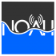
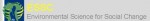
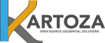
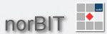
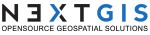

<!-- TODO: manual-review — page-builder template, verify formatting/completeness against the original -->

# Partners

InaSAFE has been contributed to by these partner organisations. Please see also our [supporters page](supporters.md) for information on the organisations funding and driving the development of InaSAFE.

         
                            
                 
                 
                
                   

                                              - NOAH

                                               - ESSC

                                               - Kartoza

                                               - opengis.ch

                                               - Sourcepole.ch

                                               - HOT & HOT Indonesia

                                               - Lutra

                                               - Norbit.de

                                               - Borys

                                               - NextGIS
