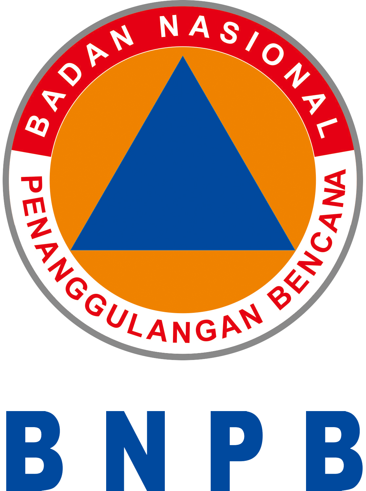

# Supporters

The development of InaSAFE has been funded and supported by these organisations.
Please also see our [partners page](partners.md) for information on the
organisations contributing to the development of InaSAFE.

-   [{ width="150" }](https://www.bnpb.go.id/)

    ---

    [BNPB](https://www.bnpb.go.id/)

-   [{ width="150" }](https://dfat.gov.au/geo/indonesia/development-assistance/Pages/disaster-risk-management-in-indonesia.aspx)

    ---

    [Australian Government](https://dfat.gov.au/geo/indonesia/development-assistance/Pages/disaster-risk-management-in-indonesia.aspx)

-   [{ width="150" }](https://www.worldbank.org/)

    ---

    [World Bank](https://www.worldbank.org/)

-   __[AIFDR](https://www.aifdr.org/)__

    ---

    Australia-Indonesia Facility for Disaster Reduction

-   __[GFDRR](https://www.gfdrr.org/)__

    ---

    Global Facility for Disaster Reduction and Recovery

