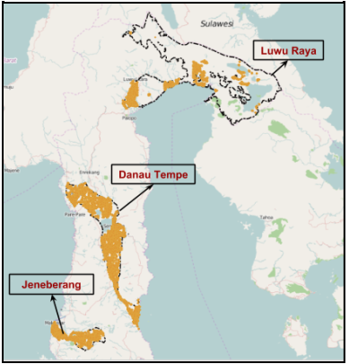

# Case Studies

Real-world disaster risk assessments using InaSAFE.

-   

    ---

    __Ambon Tsunami Contingency Plan__ — BPBD Maluku

    [:octicons-arrow-right-24: Read more](case-study-inasafe-for-ambon-tsunami-contingency-plan.md)

-   

    ---

    __Bengawan Solo Flood Contingency Plan__ — BPBD Jawa Timur

    [:octicons-arrow-right-24: Read more](case-study-inasafe-for-bengawan-solo-flood-contingency-plan.md)

-   

    ---

    __2014 Jakarta Flood__ — BPBD DKI Jakarta

    [:octicons-arrow-right-24: Read more](case-study-inasafe-for-jakarta-flood-2014.md)

-   

    ---

    __Disaster Risk Assessment in Nagekeo__ — BPBD Nagekeo

    [:octicons-arrow-right-24: Read more](disaster-risk-assessment-in-nagekeo.md)

-   

    ---

    __Flood Contingency Plan, Makassar City, South Sulawesi__ — BPBD Kota Makassar

    [:octicons-arrow-right-24: Read more](flood-contingency-plan-development-in-makassar-city-south-sulawesi.md)

-   

    ---

    __Disaster Risk Assessment in South Sulawesi__ — BPBD South Sulawesi

    [:octicons-arrow-right-24: Read more](inasafe-in-disaster-risk-assessment-in-south-sulawesi.md)

