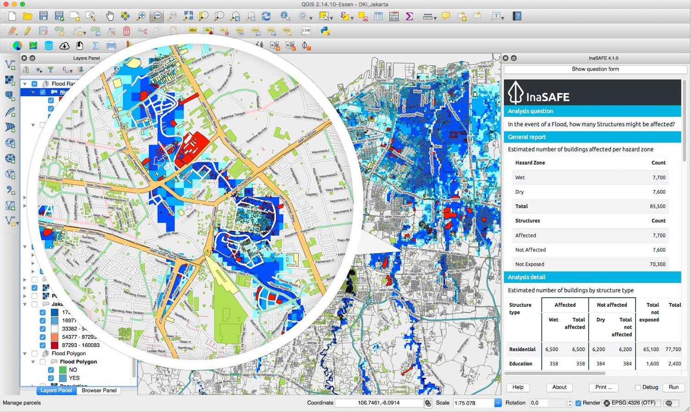

---
hide:
  - navigation
  - toc
---

# InaSAFE

InaSAFE is free software that produces realistic natural hazard impact
scenarios for better planning, preparedness and response activities. It
provides a simple but rigorous way to combine data from scientists, local
governments and communities to provide insights into the likely impacts of
future disaster events.

InaSAFE was developed jointly by Indonesia (BNPB), Australia (the Australian
Government) and the World Bank (GFDRR). It is Free and Open Source Software
(FOSS), published under the GPL v3 license — you are free to download, share,
and modify it.

[:material-account: I'm a User](manual/index.md){ .md-button .md-button--primary }
[:material-hand-heart: I'm a Contributor](contributing/index.md){ .md-button }
[:simple-github: GitHub](https://github.com/inasafe/inasafe){ .md-button }

## Explore

-   :material-book-open-variant:{ .lg .middle } __User Manual__

    ---

    Install InaSAFE and learn every tool in the plugin.

    [:octicons-arrow-right-24: Read the manual](manual/index.md)

-   :material-school:{ .lg .middle } __Training__

    ---

    Curricula and tutorials for OpenStreetMap, QGIS, and InaSAFE.

    [:octicons-arrow-right-24: Start training](training/index.md)

-   :material-newspaper-variant-outline:{ .lg .middle } __News & Events__

    ---

    Release announcements and InaSAFE events.

    [:octicons-arrow-right-24: See what's new](news/index.md)

-   :material-map-marker-radius-outline:{ .lg .middle } __Case Studies__

    ---

    How InaSAFE has been used for real disaster risk assessments.

    [:octicons-arrow-right-24: Read case studies](case-studies/index.md)

-   :material-information-outline:{ .lg .middle } __About__

    ---

    Governance, partners, people, and supporters behind InaSAFE.

    [:octicons-arrow-right-24: About InaSAFE](about/index.md)

-   :material-account-group-outline:{ .lg .middle } __Contributing__

    ---

    Guides for users, coders, translators, and documentation writers.

    [:octicons-arrow-right-24: Get involved](contributing/index.md)

## Latest news

- [InaSAFE 5.0 is released](news/inasafe-5-0-is-released.md) — 2018-11-15
- [InaSAFE 4.4 is released](news/inasafe-4-4-is-released.md) — 2018-06-03
- [InaSAFE 4.1 is released!](news/inasafe-4-1-is-released.md) — 2017-06-13

[:octicons-arrow-right-24: All news](news/index.md)

## Developed by

-   { width="150" }

-   { width="150" }

-   { width="150" }

[:octicons-arrow-right-24: All supporters](about/supporters.md)
