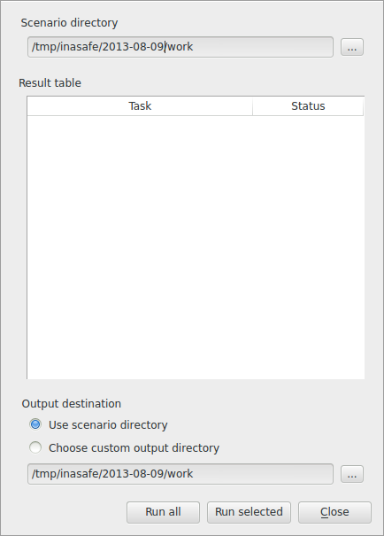
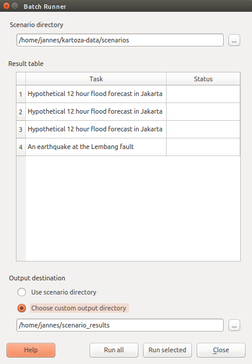
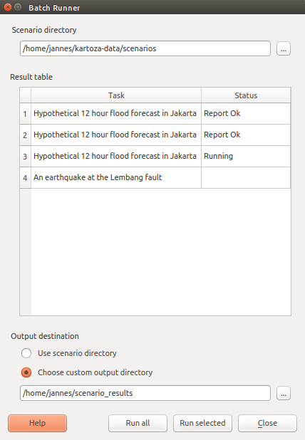
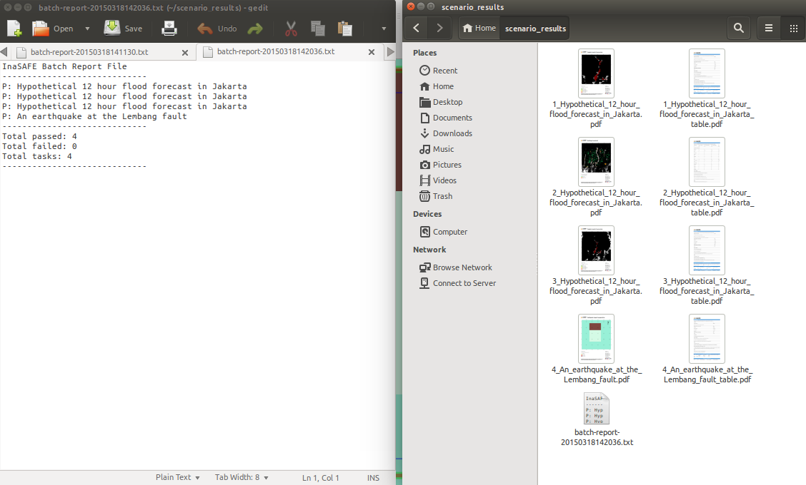

# Batch Runner

   *Batch Runner*

With this tool you can set up numerous scenarios and run them all in one go.
For example, in a typical use case you might define a number of flood impact
scenarios all using a standard dataset, such as `flood.shp`. As new flood 
data becomes available you replace `flood.shp` and rerun the scenarios 
using the batch runner. Using this approach you can quickly produce regional 
contingency plans as your understanding of hazards changes. When you run the 
batch of scenarios, PDF reports are generated automatically and all placed in 
a single common directory making it easy for you to browse and disseminate the 
reports produced.

# Steps for using the Batch Runner

1. Create a normal scenario.  Run the scenario to make sure it is valid.
2. Save the scenario tb_save_scenario use an easily accessible folder.
3. Repeat the previous step until a few scenarios have been saved.
4. Go to the Window menu --> Plugins --> InaSAFE --> Batch Runner you should see a dialog box like below

   *Batch Runner Directory*

5. Set the scenario directory to the one used in step 2.  If this is done correctly the results table will list your saved scenarios.
6. Set output destination to an easily accessible directory, this is where all your reports will go.
7. Run all your scenarios it should look like below

   *Batch Runner Busy*

 look in the output destination.  You should see all the reports and a batch report confirmation.

   *Batch Runner Results*
