# InaSAFE Panel

This document describes the usage of the InaSAFE 'dock panel' - 
the primary interface for running risk scenarios within the QGIS environment.

!!! note
    In order to use InaSAFE effectively,
    you should also read the keywords and
    impact_functions documentation before getting started.
    

The InaSAFE dock panel is the main way to interact with the tools that
are provided in InaSAFE. After you have installed the InaSAFE
plugin, the dock panel will automatically load in QGIS and appear somewhere
on your screen. It looks like this:

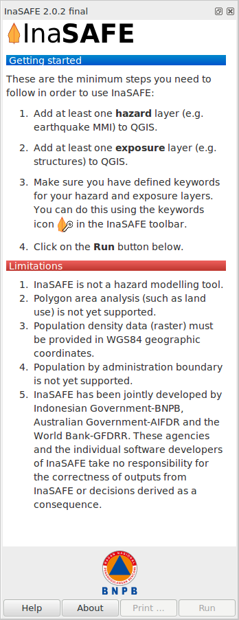

   *Docking Panel*

Drag and drop the dock panel to reposition it in the user interface.
For example, dragging the panel towards the right margin of the QGIS
application will dock it to the right side of the screen.

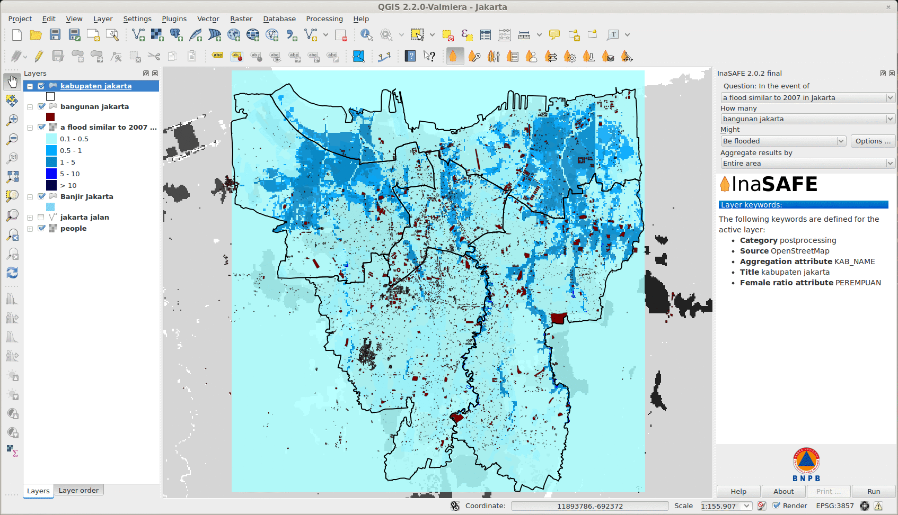

   *Dock positioned on the right with a project loaded*

There are three components within the panel:

- the **Questions** area
- the **Results** area
- the **Buttons** area

At any time you can obtain help in InaSAFE by clicking on the
**Help** buttons provided on each dock and dialog.

## The questions area

The objective of InaSAFE is to make it easy to perform
an impact analysis. The questions area provides a simple way to
formulate the scenario question. All questions are formulated in
the form:

   If [**hazard**] how many [**exposure**] might [**impact**].

For example:

   If **there is a flood** how many **schools** might **be closed**.

In order to answer such questions, the InaSAFE developers have built
a number of **impact functions** that cover scenarios such as flood,
tsunami, volcanic ash fall, earthquake and more. Visit impact_functions
for detailed information on each impact function.

To formulate these questions, various layers must be loaded into QGIS that
represent either **hazard** or **exposure** information.

- A **hazard** (**In the event of**) may be represented as,
  for example, a raster layer in QGIS where each pixel in the raster represents
  the current flood depth following an inundation event.
- An **exposure** (**How many**) layer could be represented, for
  example, as vector polygon data representing building outlines, or a raster
  outline where each pixel represents the number of people resident in that
  cell.

The **impact function** (**Might**) will combine these two input layers
in a mathematical model in order to postulate what the impacts of the hazard
will be on the exposure infrastructure or people.

By selecting a combination from the **In the event of** and
**How many** combo boxes, an appropriate set of impact functions will
be listed in the **Might** combo box.

How does the InaSAFE plugin determine whether a layer
should be listed in the **In the event of** or **How many**
combo boxes? The plugin relies on simple keyword metadata associated
with each layer.

The keyword system is described in detail in keywords.
Each layer that has a keyword defining its **category** as **hazard** will
be listed in the **In the event of** combo box.
Similarly, a **category** of **exposure** in the keywords will
result in a layer being listed under the **How many** combo box.

InaSAFE uses the combination of **category**, **subcategory**, **units**
and **datatype** keywords to determine which **impact functions** will be
listed in the **Might** combo box.

The impact function can be configured (if applicable) by pressing the
**...** button next to the chosen impact function.

This is explained in more detail below under analysis_parameters.

As of InaSAFE 1.2, you can also choose an aggregation layer for both
raster and vector layers.

Aggregation allows you to specify an additional layer when defining the
analysis criteria. This layer is used to provide a by-area breakdown of
the results of the analysis. For example, if you are carrying out an analysis
for a city, you can use district areas within the city to provide per-area
results. In the absence of an aggregation layer, the analysis extent is used
as the aggregation unit. To use this option you must load a polygon
layer into QGIS that represents the areas you wish to summarise by.

!!! note
    After running an analysis, the questions area is hidden to maximise
    the amount of space allocated to the results area (see below). You can
    re-open the question area at any time by pressing the :guilabel:`Show
    question form` button.
    

## The results area

The results area is used to display feedback
to the user. Once an impact scenario has been run (see next section),
a summary table will be shown.

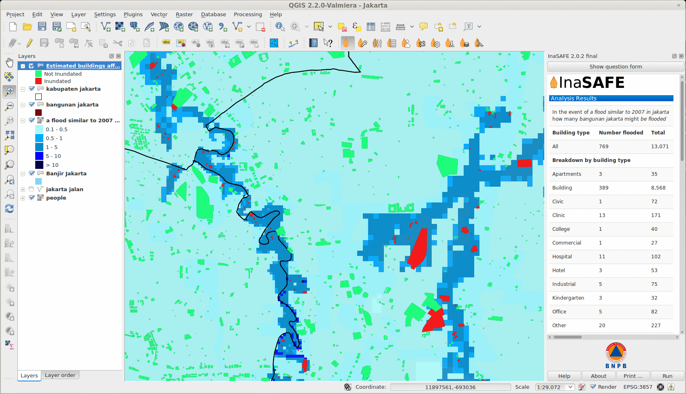

   *Results shown after processing of scenario*

If you select an **impact layer** (i.e. a layer that was produced using an
InaSAFE impact function), in the QGIS Layers panel, this summary will
also be displayed in the results area.

When you select a **hazard** or **exposure** layer in the QGIS Layers panel,
the keywords for that layer will be shown in the **Results** area,
making it easy to understand what metadata exists for that layer.

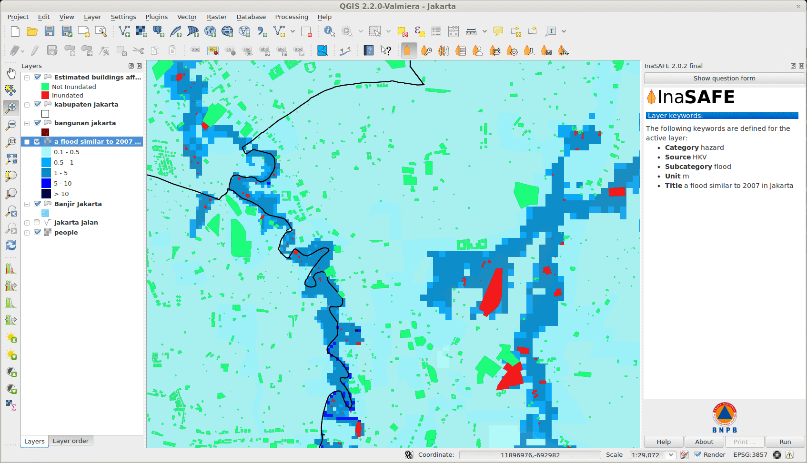

   *Showing keywords for active layer*

The **Results** area is also used to display status information. For
example, when a suitable combination of **hazard**
(**In the event of**), **exposure** (**How many**) and
**impact function** (**In the event of**) are selected, the results
area will be updated to indicate that you can proceed to run the impact
scenario calculation. The **Run** button will be activated.

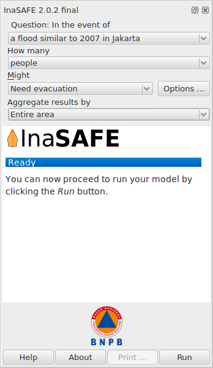

   *Run button activated*

Finally, the results area is also used to display error
messages so that the user is informed as to what went wrong and why. You
may need to scroll down a bit in the window.

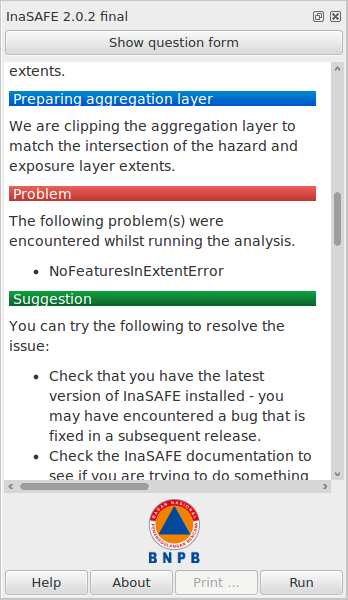

   *Showing error messages*

To allow more space for the results your question is automatically hidden
to make the results area as large as possible for displaying the results.
If you want to have a look again what the question was that you formulated
click on the **Show question form** button at the top of the results 
area.

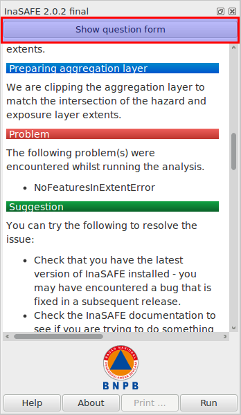

   *Show question form*

To hide the question again to have more space for the
results, simply make active the layer which InaSAFE
created during the calculation in the Layers panel.

!!! note
    At the bottom of the error display you may see a button like the 
    following. Click on this button to display a box which contains
    diagnostic information that can be submitted as part of a bug
    report if you think the error was incorrect.
    
    .. image:: /static/user-docs/toggle-traceback.*
      :scale: 75 %
    

## The buttons area

The buttons area contains four buttons:

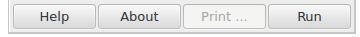

   *Buttons Area*

- **Help** - click on this if you need context help, such as the
  document you are reading right now!
- **About** - click on this to get information about InaSAFE.
- **Print...** - click on this if you wish to create a PDF of your
  impact scenario project or to generate a report and open it in composer for
  further tuning. An **impact layer** must be active before this
  button will be enabled.
- **Run** - when the combination of options in the questions
  area is suitable to be run, this button is enabled.

## Data conversions when running a scenario

When running a scenario, the data being used needs to be processed into a state
where it is acceptable for use by the impact function. In particular it should
be noted that:

- Remote datasets will be copied locally before processing
- All datasets will be clipped to the intersection of the **hazard** layer,
  the **exposure** layer and the current view extents
- All clipped datasets will be converted (reprojected) to Geographic
  (EPSG:4326) coordinate reference system before analysis

## Setting analysis parameters

Depending on the impact function you choose there will be different options
to adjust the parameters of the the question you are asking. Some impact
functions have more configurable options and some have less. This depends
on the impact function itself and the question you are asking.

To open the impact function configuration dialog click on the
**...** Button next to the **Might** combo box.

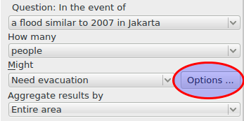

   *Open the impact function configurator*

There will be up to three tabs available:

 - **Options**: Depending in the impact function you select,
   you can influence the result of your question here (the impact function)
   by setting different initial values which are presented depending on the
   function you choose (not all impact functions may be customised).
 - **Postprocessors**: This takes the results from the impact function 
   and calculates derivative indicators. For example, if you have an affected
   population total, the gender postprocessor will calculate gender specific
   indicators such as additional nutritional requirements for pregnant women.
 - **Minimum Needs**: If the impact function calculates effects on 
   people, this calculates the minimum needs of the people affected by the 
   impact scenario.
   To use this you should have the necessary data available and
   calculate this by using the minimum_needs.

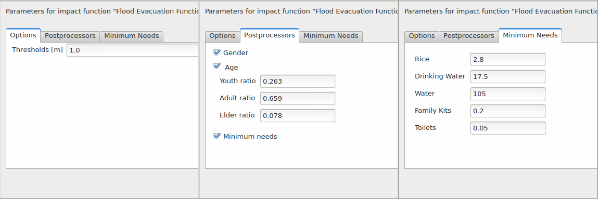

## Generating impact report

When scenario analysis is complete you may want to generate a report. Usually the
**Print...**  button will be enabled immediately after analysis. If it is
still inactive, select the impact layer in the Layers panel.

To generate a report click on the **Print...** button
in the buttons area. This will open an **Impact report** dialog.

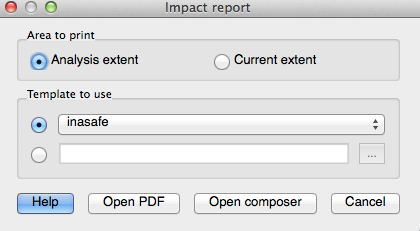

   *Impact report configuration*

The dialog has three components:

 - **Area to print** allows you to customise the extent of the report 
   map. There are two options available.
   Choose **Current extent** if the current canvas extent represents
   the necessary area. Choose
   **Analysis extent** to set the extent of the report map to the 
   impact layer extent.
 - **Template to use** allows you to select a template for the report.
   The combo box lists all templates bundled with the plugin as well as 
   templates from the user-defined template directory (see 
   toolbar_options for information on how to set the templates directory).
   It is also possible to select a custom template from any location - 
   activate the radio button under the combo box and provide a path to the 
   template using the **...** button.
 - At the bottom are four buttons: 
   **Open PDF** will generate the report and export it in PDF
   format. The resulting file(s) will be opened in your default PDF viewer.
   **Open composer** is used when you need to adjust the generated 
   report before printing. Click this button and the report will be opened
   in the QGIS composer, where you can edit it as needed.
