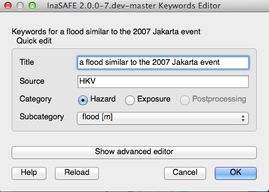
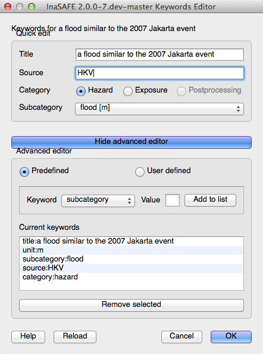
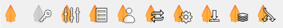

# Keywords Editor

The keywords editor provides an interface for creating InaSAFE keywords.
If you are a new user, you should probably use the
Keywords Wizard <keywords_wizard> rather than the keywords
editor as it makes it easy to specify correct keywords if you are not
familiar with the system.

For more general discussion on the keywords system used by InaSAFE, 
see the keywords system <keywords_system> documentation.

## The keywords editor graphical user interface

The graphical user interface for keywords may appear in one of two modes:

1) **Minimal mode**: In this mode, only the following options are provided:

   - **Title** - a friendly name for the dataset which will be displayed in
     reports, the user interface and so on.
   - **Source** - a field to inform from whom/where the dataset is obtained.
   - **Category** - A mandatory choice between 'hazard' and 'exposure'.
   - **Subcategory** - An amalgamated subcategory/units picklist
     (in the case of hazard) or amalgamated subcategory/datatype (in the case
     of exposure).
     In this case, the secondary characteristic (units or datatype) are
     shown in square brackets after the subcategory name e.g.
     `flood [m]` is used for subcategory 'flood', units 'm'.

This is an example of the keywords editor in minimal mode:

   *Opened keyword editor window*

2) **Advanced mode**: In this mode several extra options are provided in
   addition to the minimal mode options.
   Unlike minimal mode, in advanced mode only basic validation is performed
   and the user is given more flexibility to manually define and remove
   key/value pairs.
   Three additional sections are available:

  - **Predefined** - In this section, the user selects from a constrained list
    of keywords, enters any value and then adds the key/value pair to
    the keywords list (see below).
  - **User defined** - In this section, there is no constraint on the keywords
    entered - any single lower case word will be accepted for both the key and
    the value components.
  - **Current keywords** - In this area a complete list of all the keywords
    for the dataset is displayed.
    The keywords list here is updated when any changes are made in both the
    simple and advanced mode editors.
    It is also possible in this area to manually remove unwanted keywords
    using the **Remove selected** button.
    Multiple keywords can be removed in a single operation by holding
    `CTRL` and clicking on multiple keyword entries in the current
    keywords list and then clicking **Remove selected**.

   *Advanced mode of keyword editor*

!!! note
    Switching from hazard to exposure will clear parts of the GUI since 
    most keywords are category dependent.
    In particular, selecting **'hazard'** will remove the **'datatype'**
    key/value pair, and selecting **'exposure'** will remove the **'units'**
    key value pair.
    

## Invoking the keywords editor

The keywords editor can be invoked by selecting any layer in the
QGIS Layers panel and then going to 
**Plugins ‣ InaSAFE ‣ Keyword Editor**.
Alternatively, you may click the **Keywords Editor** button on the 
toolbar:

   *InaSAFE toolbar*

!!! note
    If you have not selected a layer,
    the keyword editor icon in the toolbar and menus will
    be disabled and appear greyed out.
    

## Saving your edits

To save your keyword edits, click the **OK** button and the
`*.keywords` file will be written to disk.

## Cancelling your edits

Cancel your changes at any time by clicking the **Cancel**
button.
No changes will be written to disk and the `*.keywords` file will
remain in its original state.
