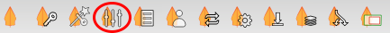
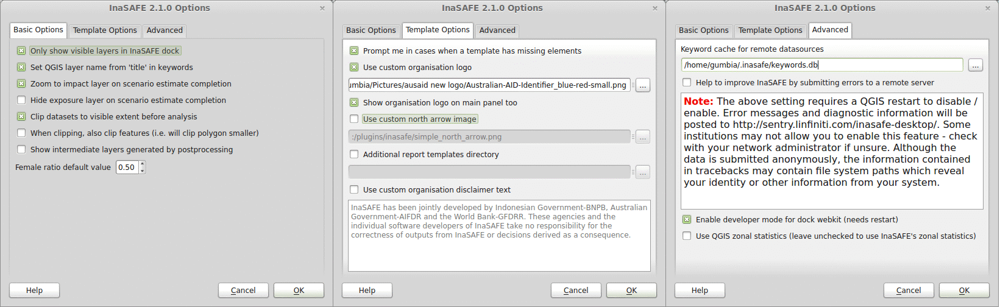

# Options

The InaSAFE plugin provides an options dialog which allows you to
define various options relating to how InaSAFE will behave.
The options dialog can be launched by clicking on the InaSAFE plugin
toolbar's **Options** button (as shown below) or by going to
**Plugins ‣ InaSAFE ‣ InaSAFE Options**.

   *Options button*

This following dialog will appear, which is divided into three tabs:

- basic_options
- template_options
- advanced

   *Options dialog*

The following options are available on the **Options Dialog**:

## Basic Options

- **Only show visible layers in the InaSAFE dock**: This option will
  determine whether **all** hazard and impact layers should be listed in the
  InaSAFE dock's combo boxes or (when checked) only visible layers.
- **Set QGIS layer name from 'title' in keywords**: This option will
  cause QGIS to name layers in the **Layers tree** using the `title`
  keyword in the layer's keywords file.
  If the layer has no 'title' in its keywords, or it has no keywords at all,
  the normal QGIS behaviour for naming layers will apply.
- **Zoom to impact layer on scenario estimate completion**: This
  option will cause the map view to zoom in/out in order to completely contain
  the InaSAFE impact scenario map output when an analysis completes.
- **Hide exposure layer on scenario estimate completion** : This
  option will cause QGIS to turn off the exposure layer used when
  InaSAFE completes the current analysis.
  You can re-enable the layer visibility again by checking its checkbox in
  the legend.
- **Clip datasets to visible extent before analysis**: This option
  will cause QGIS to clip hazard and exposure layers to the currently visible
  extent on the map canvas.
- :guilabel:`When clipping, also clip features (e.g. will clip polygon
  smaller)`:
  This option will clip any polygons that extend beyond the analysis extents
  so that they are contained by the analysis extent. For example if you have
  a flood hazard polygon layer that extends far beyond your area of interest,
  the flood polygons will be reduced so that only the part inside of your
  area of interested is retained. This can speed up processing time.
- **Show intermediate layers generated by postprocessing**: This
  option will cause QGIS to show the intermediate files generated by the
  postprocessing steps in the map canvas.
- **Female ratio default value**: This is the default female to total
  population ratio used for generating gender breakdowns.

## Template Options

- **Prompt me in cases when a template has missing elements**: When
  enabled, this option will cause InaSAFE to prompt the user when a 
  template has a missing element if the user tries to print the report or open 
  it in the composer.
- **Use custom organisation logo**: This option is used to determine
  the custom logo that will be used as an organisational logo in the PDF of your
  impact scenario project. If this option is disabled, InaSAFE will use 
  the default organisation logo.
  See toolbar_reports in the InaSAFE User's Manual for more
  information on the reports.
- **Show organisation logo in the main panel too**: If this is enabled
  then the selected organisation logo (if any) will be displayed in the bottom
  of the InaSAFE dock panel.
- **Use custom north arrow image**: This option is used to determine
  a custom north arrow that will be used as the north arrow image in the PDF of
  your impact scenario project. If this option is disabled, InaSAFE will use the
  default north arrow image.
- **Additional report templates directory**: This option is used to
  determine a directory with custom templates. Templates from this directory
  will be available for use when generating reports in your impact scenario
  project.
- **Use custom organisation disclaimer text**: This option is used to
  change the default disclaimer text printed in reports. If this is enabled, 
  enter your own text and it will be used instead of the default one.
  See toolbar_reports in the InaSAFE User's Manual for more
  information on the reports.

## Advanced

- **Keyword cache for remote datasources**: This option is used to
  determine where keywords are stored for datasets when it is not possible
  to write them into a `.keywords` file.
  See keywords_system in the InaSAFE User's Manual for more
  information on the keywords system.
- **Help to improve InaSAFE by submitting errors to a remote server**:
  This option, when enabled, will submit diagnostic information back to an
  InaSAFE project server in the event of any error taking place that
  we are able to trap.
  The information provided is useful to the InaSAFE team to improve
  the robustness of the software and to spot trends in issues
  people encounter.
  Please note the warning text below this option which is included here in
  full:

!!! note
    The above setting requires a QGIS restart to disable/enable.
    Error messages and diagnostic information will be posted to
    http://sentry.linfiniti.com/inasafe-desktop/ .
    Some institutions may not allow you to enable this feature - check with
    your network administrator if unsure.
    Although the data is submitted anonymously, the information contained in
    tracebacks may contain file system paths which reveal your identity or
    other information from your system.
    

- **Enable developer mode for dock webkit (needs restart)**:  With
  this option enabled, you can right-click on the report area and use the
  webkit debug tools to debug the output.
  **This option is intended for advanced users only.**
- **Use QGIS zonal statistics**: With this button you can toggle
  between using QGIS internal zonal statistics or the one that comes with
  InaSAFE.

!!! note
    You can click on the **Help** button at any time and it
    will open the help documentation browser to this page.
    

!!! note
    Pressing **Cancel** at any time will close the options dialog and
    any changes made will **not** be applied.
    Pressing **OK** at any time will close the options dialog and any
    changes made **will** be applied immediately.
    

!!! note
    The exact button order shown on this dialog may differ depending on
    your operating system or desktop environment.

