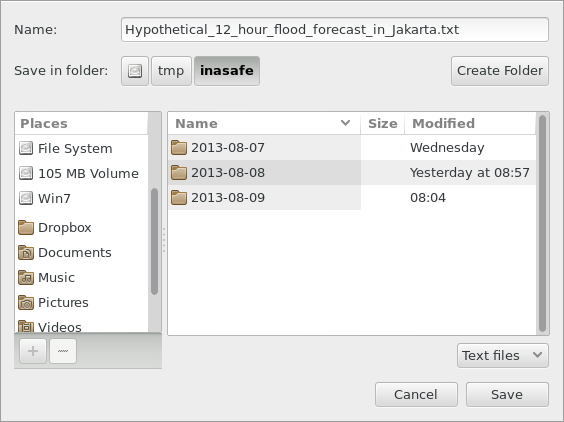

# Save Scenario

The Save Current Scenario tool allows you to save scenarios
(tb_save_scenario) and batch run them again in the batch runner
tool (batch_runner) in one go:

   *Save current scenario*

This is the tool you need to prepare/save scenarios for the
tb_batch_runner. It lets you save the current visible scenario
in QGIS to a `.txt` file. Once saved you can reopen this file as a
scenario again in Batch runner and recalculate it.

A more detailed description of the batch runner is available in
batch_runner.

!!! note
    This tool currently does not store the impact function parameters
    you may have set. Consequently all impact functions will run using their
    default options.

