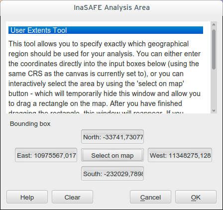

# User Extents

As of version 2.2, it is possible to explicitly define the extents that
should be used for the analysis. You can use the new
**Plugins-->InaSAFE-->Set the analysis area for InaSAFE** to
invoke the extents selection dialog.

   User extents dialog

It is important do understand the logical workflow for your custom defined
extents and their relation to the layer and viewport extents. There are three
possible permutations for the basic extents clipping behaviour:

- **No clipping**: use full extents of the union of the hazard and exposure
    datasets regardless of your current viewport (where you are zoomed to on
    the map. You can enable this behaviour in the options dialog by unticking
    **Clip datasets to visible extents before analysis**.

- **Clip to visible viewport extents**: use the common overlapping area of
    hazard, exposure and the current extents for the analysis (enable this
    behaviour by ticking :guilabel:`Clip datasets to visible extents before
    analysis`).

- **Clip to the user defined extents**: use the common overlapping area of
    hazard, exposure and the user defined extents for the analysis (enable this
    behaviour by using :menuselection:`Plugins-->InaSAFE-->Set the analysis
    area for InaSAFE`).

When you select an area using the user extents dialog (either by pressing the
**Select on map** button, or by manually typing the extents
coordinates) the user extent will be shown with a blue rectangle on the map
if you have rubber band previews enabled. Creating a user defined analysis
extent will enable the third behaviour described above, and any analysis done
will disregard the current viewport extents and only consider the intersection
of the user defined analysis ares and the hazard and exposure layers.

**Note:** To disable user defined extents, :menuselection:`Plugins-->InaSAFE-->Set
the analysis area for InaSAFE` then click the **clear** button.

