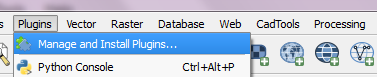
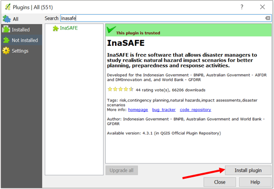
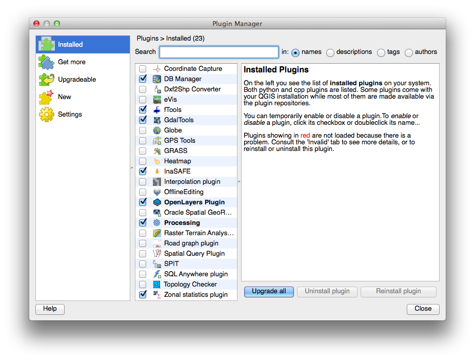

# Installation

!!! note
    InaSAFE is a plugin for QGIS, so QGIS must be installed 
    first via the QGIS Python Plugin Repository.
    

To install InaSAFE, use the plugin manager in QGIS.

- Go to **Plugins -> Manage and install plugins** menu.

- Go to the search box and type `InaSAFE`.

- Select InaSAFE and click **Install plugin** and 
   wait for a moment until the InaSAFE dock appears
   in the right side of QGIS main window.

- Close the plugin manager window.

For more information on QGIS and InaSAFE 
see ../training/socialisation/introduction_to_qgis.

## From Zip Archive

!!! warning
    This installation method is not recommended unless you have no
    internet access or wish to use a specific version of InaSAFE.
    If this does not apply to you, use the plugin repository method
    described above.
    

We make regular releases of the InaSAFE plugin and they are available at
http://plugins.qgis.org/plugins/inasafe/.
Simply choose the most recent (i.e. the one with the largest version number)
and save it to your hard disk.

Extract the zip file into the QGIS plugins directory.

!!! note
    Depending on your version of QGIS the plugin directory is either
    under a subdirectory of `.qgis` (QGIS versions < 2.0) or 
    `.qgis2` (QGIS version >= 2.0).
    

Depending on your Operating System (Windows, Linux,
OS X) and the version of QGIS, the directory containing the
plugins will be in:

- Windows: `C:\\Users\\<your username>\\.qgis(2)\\python\\plugins\\`
- Linux: `~/.qgis(2)/python/plugins/` (where "~" means
  `/home/<your username>/`
- OS X: `~/.qgis(2)/python/plugins/` (where "~" means
  `/home/<your username>/`

!!! note
    `.qgis(2)` means that the directory is either called
    `.qgis` or `.qgis2`.
    

If you are running Windows with QGIS 2.8 or above, do the following:

1. Locate the directory
   `C:\\Users\\<your username>\\.qgis2\\python\\plugins`.

2. Extract the plugin which you downloaded in this directory. It should be 
   available as
   `C:\\Users\\<your username>\\.qgis2\\python\\plugins\\inasafe\\`.

OS X and Linux users must follow the same procedure but with the appropriate
directory, `~/.qgis2/python/plugins/`.

Once the plugin is extracted, start QGIS and enable it from the plugin manager.

3. To do this go to **Plugins ‣ Manage and Install Plugins** and type 
   `inasafe` into the search box.

4. You should see the InaSAFE plugin appear in the list.
   Tick the checkbox next to it to enable the plugin.

   *Plugin Manager*

## Downgrade the InaSAFE plugin to a selected version

If you are using an older version of QGIS or simply want to install a specific
version of the InaSAFE plugin you must
perform the following steps:

1. Fetch the plugin manually from http://plugins.qgis.org/plugins/inasafe/. 
   Select your preferred version number and click **Download**.

2. Delete the `inasafe` folder from your plugins directory. The location
   of this directory will vary depending on your operating system (see the
   previous section). 
   For Windows users the `inasafe` directory would be in
   `C:\\Users\\<your username>\\.qgis2\\python\\plugins`.

3. Extract the downloaded version into that folder, effectively replacing
   the previous version with whichever version you downloaded in step 1.

4. Restart QGIS.

## System Requirements

The requirements for running InaSAFE are:

 - a standard PC with at least 4GB of RAM running Windows, Linux or OS X
 - QGIS long term release version (http://www.qgis.org);
   InaSAFE requires QGIS version 2.8 or newer
