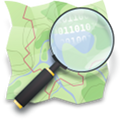
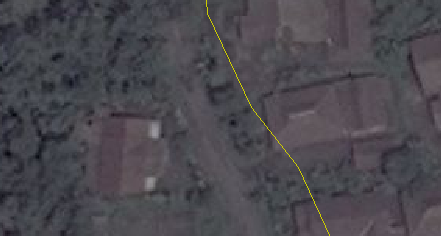
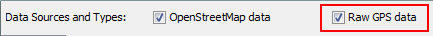
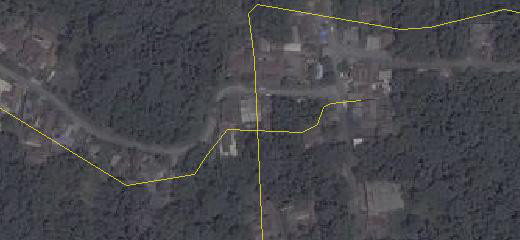
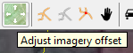
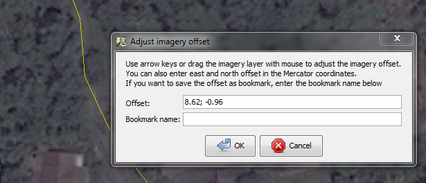

# Chapter 10: Imagery Offset

**Learning Objectives**

-  Understanding definition of Imagery Offset 
-  How to adjust the Imagery Offset

## 10.1 Overview of Imagery Offset

Using aerial imagery is the most widely used approach to mapping in OpenStreetMap. 
Mappers typically use Bing Satellite, or imagery from another provider as a background layer while mapping. 
We have already seen this in previous sections.

Imagery providers usually do a pretty good job of georeferencing their imagery, but occasionally the images can be out
of position. This is particularly true in hilly or mountainous areas, where it can be difficult 
to stretch a flat image over an area of the Earth with many contours. When you load imagery in JOSM, 
it can sometimes be ten meters or more from its true position. This is called imagery offset.

We’ve learned about two major ways of making maps – one is by utilizing aerial imagery to identify features 
on the ground, and another is by using GPS to record tracks and waypoints and then add them to OpenStreetMap. 
The advantages of aerial imagery is obvious. It is easier for you to see the whole picture, to observe various details from the image, consider your knowledge of the area, and easily trace roads, buildings, and areas. 

One key advantage of GPS, is that it doesn’t suffer from offset like imagery. A GPS will always provide you with 
a correct latitude and longitude. The only exception is when the satellite signals are interrupted by high buildings
and mountains, but in this case it is easy to recognize the error. Showing the GPS track in this image, compared with Bing aerial imagery layer in the below figure:

   *Imagery Offset*

It is clear that the GPS track is likely to be accurate and the satellite imagery beneath it is out of place.

So now we must ask, “if the imagery may be out the place, how can we still use it and make accurate maps?”

## 10.2 CORRECTING IMAGERY OFFSET

The best references for adjusting imagery are GPS tracks that follow roads. And the more GPS tracks 
that you have to reference, the more accurate you will be able to align your imagery. Since OpenStreetMap users often
upload their GPS tracks to the OSM database, we can download them and use them to align our imagery.

1. Click on the **Download** button.

2. Check the box next to **Raw GPS Data** near the top of the Download window. Select your area and click 
   **Download**.

3. This will download an additional layer to JOSM containing GPS tracks. 
   Depending on how many tracks have been uploaded by OSM users, you may see few tracks (or even no tracks):

   *Imagery Offset*

4. To adjust an imagery layer, click on the **Adjust imagery offset** button at the top of JOSM.

5. Ignoring the box that pops up, use your mouse to drag the imagery layer so that it aligns correctly with 
   the GPS tracks. The GPS tracks should line up with the roads on the imagery as closely as possible. 
   You will see the offset numbers in the box change.

   *Setting Imagery Offset*

6. If you like, you can save these offset settings by entering a bookmark name and then clicking **OK**. 
   You can then automatically apply the same settings later by going to **Imagery ‣ Imagery Offset** 
   and clicking on your bookmark.

7. If you do not want to save the offset, simply click **OK** without entering a bookmark name.

What if there are no GPS tracks on OpenStreetMap, and you don’t have a GPS? Without GPS tracks, it is difficult to align imagery. If it is a relatively empty area (not much mapped), you might choose to simply use the imagery 
as it is and correct the data later.

Go to next chapter --> <ch11-export-osm-data>
