# Chapter 3: The Basics of QGIS

**Learning Objectives**

-  Downloading QGIS
-  Install QGIS
-  Open a previously created QGIS project
-  Understand the layers panel
-  Access basic tools through toolbar
-  Clean up the toolbar
-  Show a map in the map window

In this chapter we begin using QGIS. 
We’ll see how to install the software and understand the layout, interface and core functions of the software. 
By the end of this chapter, you’ll be on your way to becoming a competent GIS user!

Note that if you have previously installed QGIS, feel free to skip ahead to *section three*. 
Otherwise, let’s start here and get QGIS installed.

## 3.1 Getting QGIS

1. Open your web browser and in the address bar at the top of the window, type `qgis.org`. Press **Enter**.

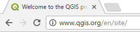

The QGIS website will look something like this:

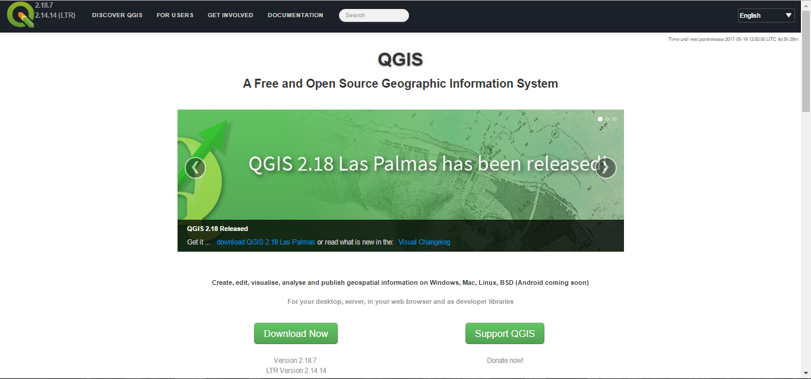

2.  Click **Download Now**

3.  If you are using Windows, scroll down to the **Long Term Release**
    version and click on **QGIS Standalone Installer Version 2.14 (32 bit).** 
    Your exact version number may be different.

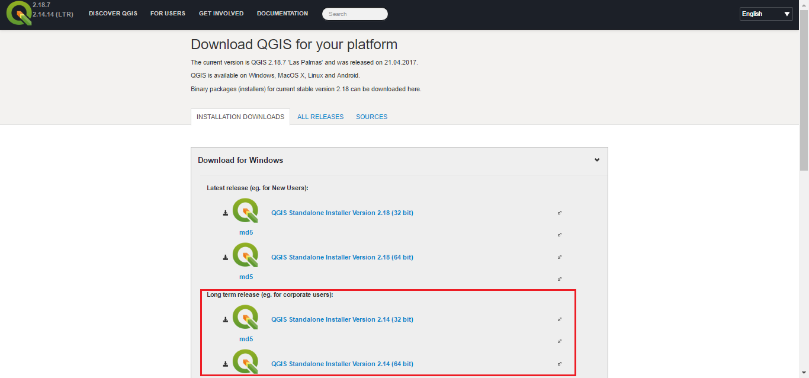

4.  If you are not using Windows, select your Operating System from the menu. 
    Follow the installation instructions.

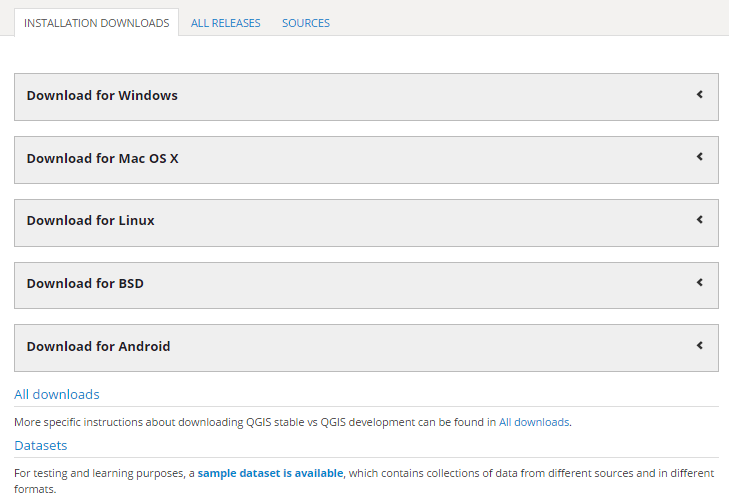

5.  When the file is downloaded, run it and follow the instructions to install QGIS.

## 3.2 Installing QGIS

1.  Open the folder where you have the QGIS installation file.

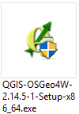

2.  Run the installation file. If you are installing QGIS version 2.x, it should look like this:

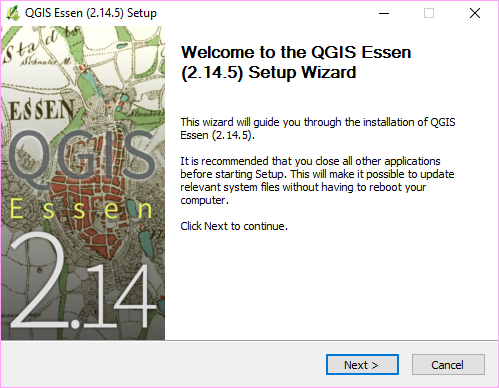

3.  Click on **Next**.

4.  Click **I Agree** to agree with the conditions in the license agreement.

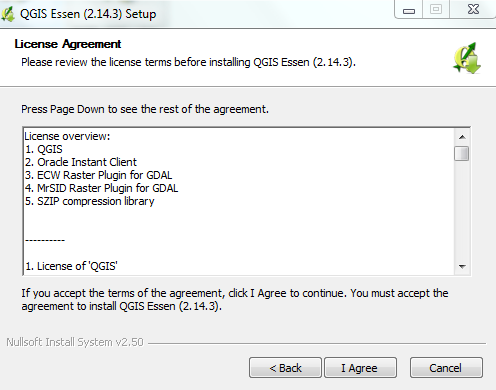

5.  The next window asks where you would like to install QGIS. In most cases, the default should be fine. Click on **Next**.

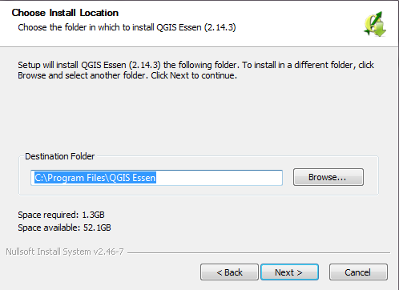

6.  In the next window, click **Install** without checking any of the boxes.

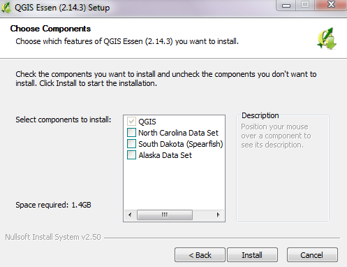

QGIS will begin to install. It may take a few minutes to complete.
     
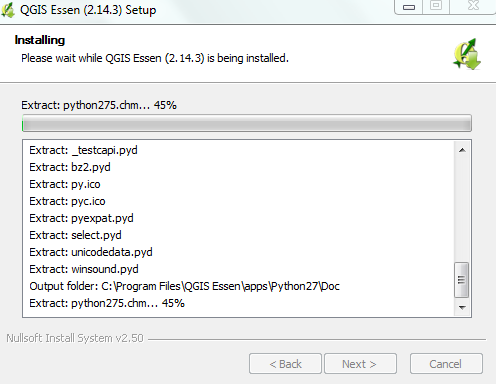

7.  click **Finish** to complete the installation. Your computer will automatically reboot.

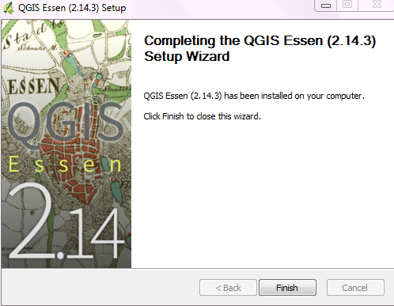

8.  Now open QGIS from the Start Menu.

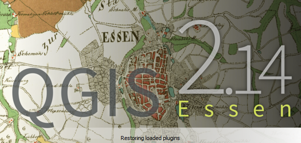

QGIS will look something like this:

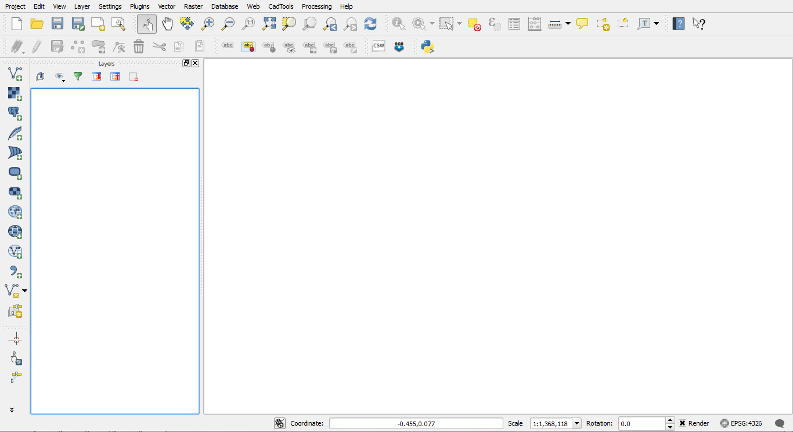

## 3.3 QGIS user interface layout

Next we will open up a QGIS project, and take a look at the different pieces of the QGIS interface. 
If you installed InaSAFE previously, make sure it is closed by clicking on the X in the upper right corner of the InaSAFE panel. 
If it isn’t open or you haven’t installed it yet, carry on. 
We will come back to this later.

1.  Click on the folder icon on the upper toolbar or go to **Project --> Open...**

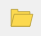

2.  Navigate to the tutorial files and go into the **QGIS for Disaster Management/ directory**. Open the file named **Chapter_3_Basic QGIS.qgs**.
    QGIS should now look something like the following image. 
    Let’s pause for a moment and go over the various components of the QGIS interface.

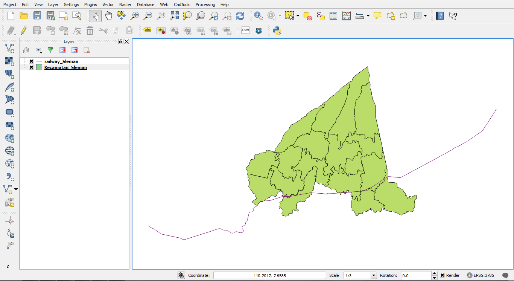

**Map Canvas**

This is the window where the map is shown. 
Our project has two different files open, one which shows districts of the Sleman regency, 
and another that shows the railway line running through the area. 
Both of these files are drawn together in the map canvas.

**Layers Panel**

On the left side of QGIS is the layers list. This lists the layers, or files, that are loaded into our QGIS project. 
In this project, we have two layers, **Kecamatan_Sleman** and **railway_Sleman_OSM**.

The layers panel not only shows all the files that are currently opened, but also determines the order that they are drawn on the map canvas.
A layer that is at the bottom of the list will be drawn first, and any layers above it will be drawn on top.

1.  Click on the layer **railway_Sleman_OSM** 
    and drag it below the layer named **Kecamatan_Sleman**.

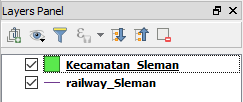

Notice how the map canvas changes. The railway layer is now shown below the district layer, and part of the railway is now obscured. 
A map should never show railway hidden beneath district areas, so go ahead and move the layers back.

2.  Uncheck the box next to a layer’s name. It will be hidden from the
    map canvas.

3.  Expand collapsed items by clicking the arrow or plus symbol beside them. 
    This will provide you with more information on the layer’s current appearance.

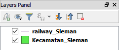

4.  Right-click on a layer to view a menu with menu extra options. 
    You’ll be using some of them before long, so take a look around!

**Toolbars**

At the top of QGIS are a large number of tools, which are contained with various *toolbars*. 
For example, the *File* toolbar allows you to save, load, print, and start a new project. 
We have already used one of these tools when we opened this project.

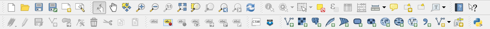

By hovering your mouse over an icon, the name of the tool will appear to help you identify each tool.

The number of tools (buttons) can seem a bit overwhelming at first, 
but you will gradually get used to them. 
The tools are grouped into related functions on toolbars. 
If you look closely, you can see a vertical array of ten dots to the left of each toolbar. 
By dragging these with your mouse, you can move the toolbar to a more convenient position, or separate it so that it stands on its own.

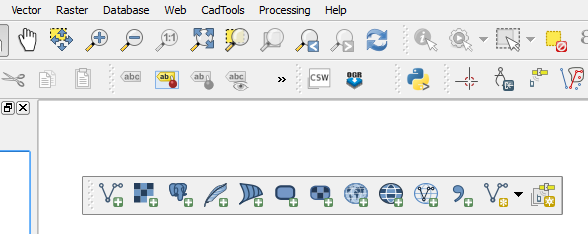

If you feel overwhelmed by the number of toolbars, you can customize the interface to see only the tools you use most often, 
adding or removing toolbars as necessary.

1.  To add or remove a toolbar, right-click on any of the toolbars, or go to **View --> Toolbars**.

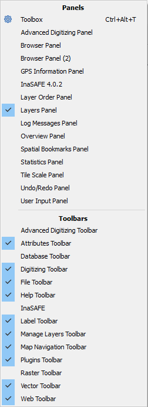

2.  Let’s remove some of the toolbars that we will not be using in this training, to make the interface a bit cleaner. 
    Right-click on the toolbar, and uncheck the boxes next to the following toolbars:

     -  Advanced Digitizing

     -  Database

     -  GRASS

     -  Label

     -  Raster

     -  Vector

3.  After removing these toolbars and moving them around, your tools should look like this:

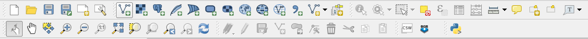

Even if they are not visible in a toolbar, all of your tools will remain accessible via the menus. 
For example, if you remove the *File* toolbar (which contains the *Save* button), 
you can still save your map by going to **Project --> Save**.

**Status Bar**

The status bar shows information about the current map. 
It allows you to adjust the map scale and see the mouse cursor’s coordinates on the map.

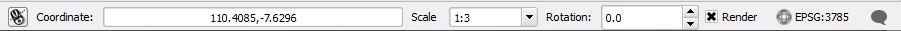

The coordinates of this map are the same type of coordinates that are recorded by GPS devices. 
The status bar show shows the longitude and latitude of your mouse cursor.

This may not all be clear right now, but as you progress in your knowledge of GIS it will make more and more sense.

## 3.4 Adding a Vector Layer

Now we will add an additional layer containing roads to our project.

1.  Click on the **Add Vector Layer** button on the toolbar.

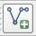

2.  A dialog box will open. Click the **Browse** button.

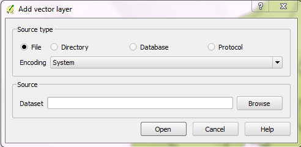

3.  Navigate to the file `QGIS for Disaster Management/Sleman/Jalan_Sleman_OSM.shp`. 
    Select the file and click **Open**.

!!! note
    One of the most common file formats are **shapefiles**, which end with the extension **.shp**. 
          Shapefiles are often used to save geodata, and are commonly used with GIS applications like QGIS.
    

4.  You should now see your new layer appear both in the map canvas and in the layers panel. 
    It should be drawn above both the district and railway layers.

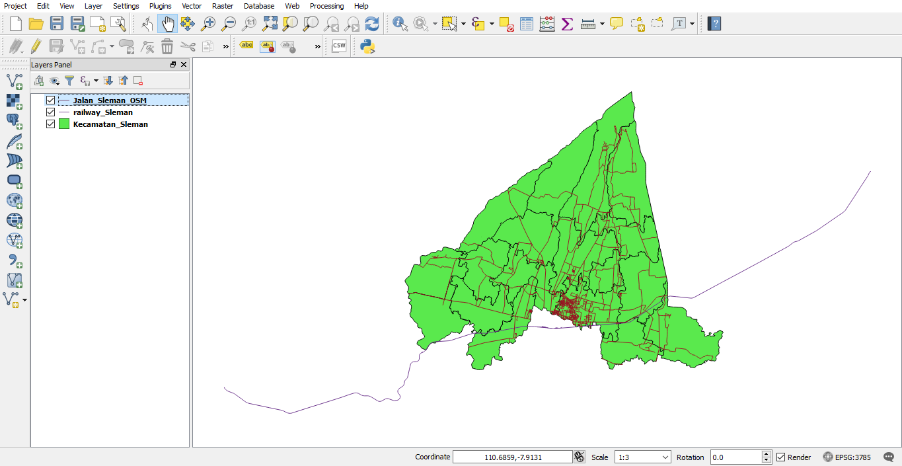

## 3.5 Basic QGIS Tools

We’ve already taken a look at the QGIS toolbar and seen the tools for opening a project and adding a new layer. 
Here’s a list of some other commonly used tools. 
Feel free to play around with them if you like. 
The important thing for now is to start getting familiar with QGIS.

+--------------------------------------------+-------------------------+-------------------------------------------------+
| .. image:: /static/training/qgis/3_027.*   | Toggle Editing          | Edit features in a layer                        |
+--------------------------------------------+-------------------------+-------------------------------------------------+
| .. image:: /static/training/qgis/3_028.*   | Pan Map                 | Drag the map to a new location                  |
+--------------------------------------------+-------------------------+-------------------------------------------------+
| .. image:: /static/training/qgis/3_029.*   | Zoom In                 | Zoom in on the map                              |
+--------------------------------------------+-------------------------+-------------------------------------------------+
| .. image:: /static/training/qgis/3_030.*   | Zoom Out                | Zoom out on the map                             |
+--------------------------------------------+-------------------------+-------------------------------------------------+
| .. image:: /static/training/qgis/3_031.*   | Zoom Full               | Zoom so that all layers fit in the map window   |
+--------------------------------------------+-------------------------+-------------------------------------------------+
| .. image:: /static/training/qgis/3_032.*   | Open Attribute Table    | Open a layer’s attribute table                  |
+--------------------------------------------+-------------------------+-------------------------------------------------+
| .. image:: /static/training/qgis/3_033.*   | Select Single Feature   | Select a feature in the selected layer          |
+--------------------------------------------+-------------------------+-------------------------------------------------+

## 3.6 Navigating the Map

Before we examine the attributes of individual features, let’s take a quick look at how to navigate the map. 
The main controls for moving the map around and zooming in and out are by default on the panels at the top of QGIS.

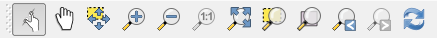

When you click on one of these buttons, it changes what you can do with your mouse in the main map window.

1.  Select the first button that looks like a hand. 
    Now hold the left mouse button down and drag the mouse in the map window. 
    This allows you to pan the map, or move it around.

2.  The button which has a plus sign below a magnifying glass allows you to zoom in on the map. 
    Select this button. 
    Using your mouse, draw a box around an area where you want to zoom in, and release your mouse.

3.  The button which has a minus sign below a magnifying glass allows you
    to zoom out on the map. Select this button and click on the map.

4.  The button that looks like a magnifying glass with red arrows pointing away from it lets you zoom to the full extent of your map.
    Click this button to see all of the data that is loaded in the project fit into the map canvas.

## 3.7 Managing Plugins

QGIS has core functionality, which we will continue to explore in this guide, 
but it also allows the use of additional **plugins**, 
which allow you to add functionality to the software. 
Again, these plugins are free. To use them, you simply need to connect to the internet and install. 
To install new plugins, make sure you are connected to the internet. 
They first need to be downloaded, and then activated. 
Some plugins are already downloaded and available, 
and you can see them by going to **Plugins ‣ Manage and Install Plugins**.

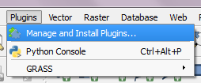

This displays a list of plugins that have already been downloaded and can be activated. 
To enable a plugin, check the box next to it in this menu. 
For now, let’s leave all the plugins as they are. 
We’re going to download and activate a new plugin in the next section.

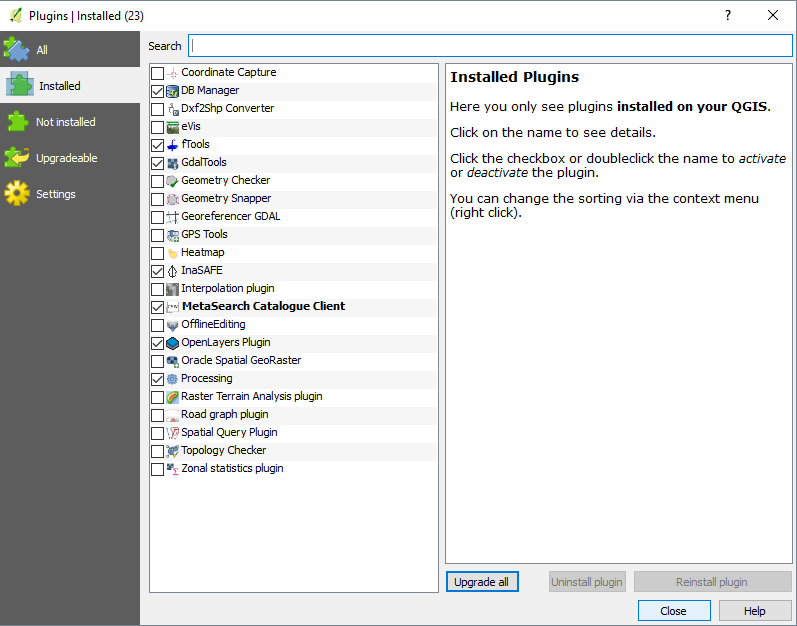

### 3.7.1 Installing Plugins

There are numerous plugins available, but they must first be downloaded. To download a plugin, click the *Not installed* tab. 
This will load available plugin repositories, and you will see a list of all available plugins for download.

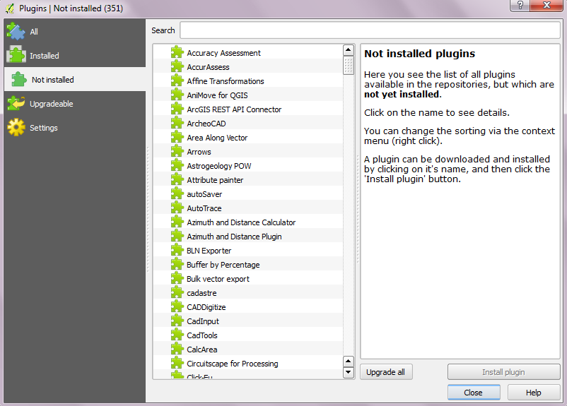

Note that plugins which have already been downloaded can be activated or deactivated from the *Installed* tab. 
If it has not yet been downloaded, downloading a plugin from the *Not installed* tab will automatically activate it.

### 3.7.2 The OpenLayers Plugin

The OpenLayers plugin allows you to view various web maps as a layer in QGIS. 
This means that you can access the OSM slippy map, Google Maps and Bing Maps from QGIS directly. 
Follow along and we’ll see how this works.

1.  Go to **Plugins --> Manage and Install Plugins…** and click on the **Not installed** tab. 
    Type `openlayers` into the Search box.

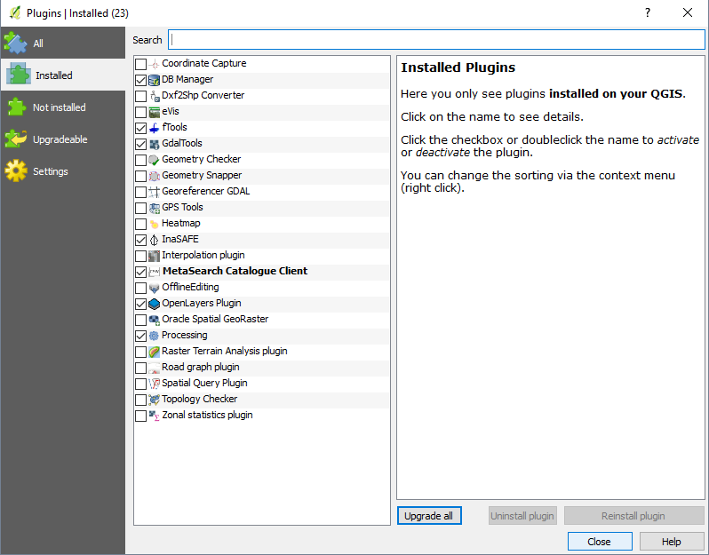

2.  Select **OpenLayers Plugin** from the list and click **Install plugin**.

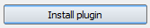

It may take a few minutes to download.

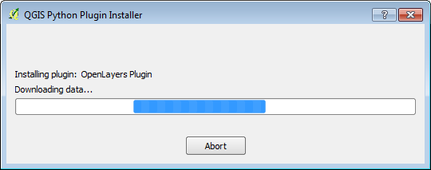

3.  When the download finishes click **OK**.

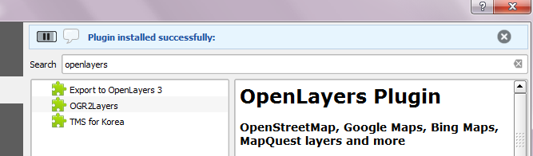

4.  Now the OpenLayers plugin is installed and activated. 
    Click the **Installed** tab to see it in your list of active plugins. 
    Click **Close** when you are finished.

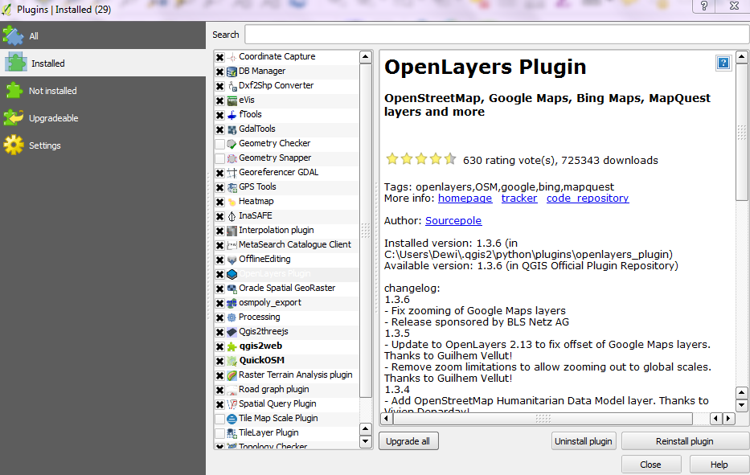

5.  The new plugin provides a menu which offer extra functionality. 
    Go to ***Web --> OpenLayers plugin*** to see various map layers that can be loaded.

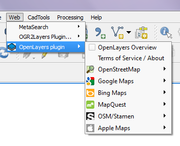

6.  Go to **Web --> OpenLayers plugin --> Bing Maps --> Bing Aerial**. 
    A new layer called “Bing Aerial” will be added to the Layers panel, and the imagery will load in the map canvas. 
    If the layer is above your other layers, drag it to the bottom of the layers list.

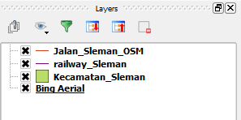

Your project should now look like this:

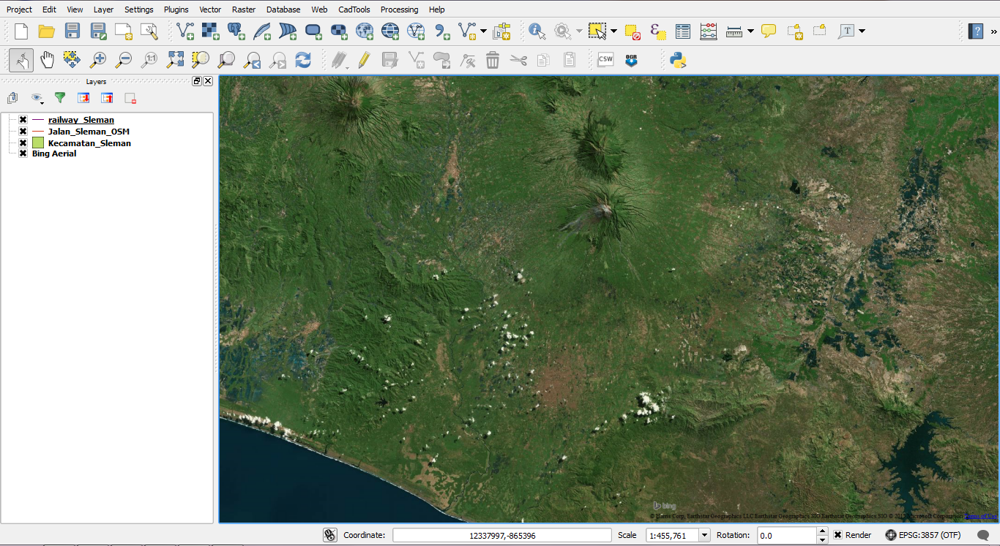

If you pay attention, there is something wrong with the maps. 
Can you guess what it is? 
All three layers above Bing Aerial layers should be shown on the map.

7.  To fix this, go to **View --> Panels** and check the box next to **Layer Order Panel**.

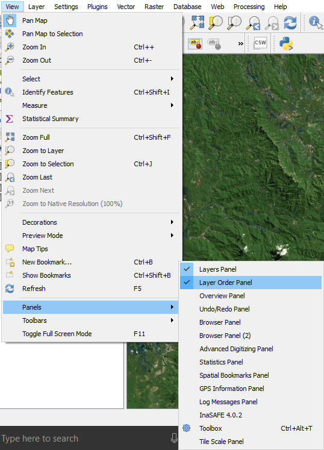

8.  The Layer order panel will appear next to Layers panel (1). 
    Click that panel and uncheck **Control Rendering Order** (2).

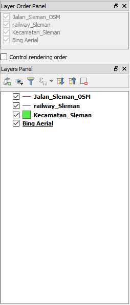

9.  Return to the Layers panel. The map should appear in correct order.
    All layers above Bing Aerial will show up on the map canvas as in the image below.

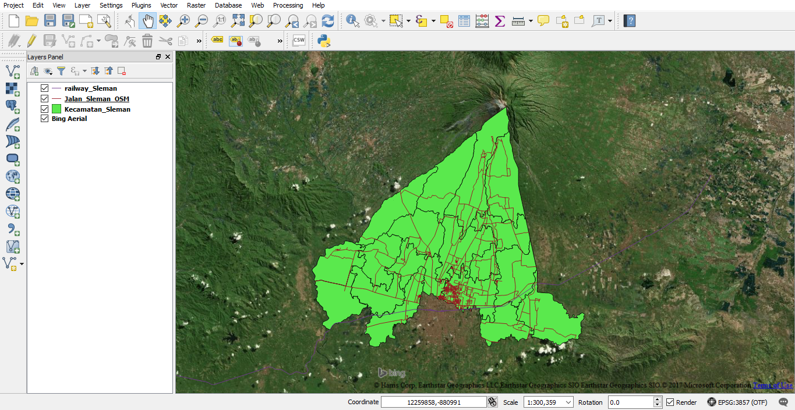

Adding a layer such as Bing Aerial will change the Coordinate Reference System, or CRS, of your project. 
Essentially this means that your project is not using longitude and latitude coordinates anymore. 
This shouldn’t affect you right now, but it will make sense later when we cover CRSes.

10. If the map data does not appear to match up correctly with the aerial imagery, it may be due to different CRSes. 
    You can fix this problem by going to ***Project --> Project Properties*** 
    and checking the box next to *Enable ‘on the fly’ CRS transformation*.

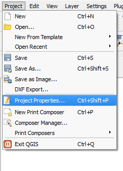

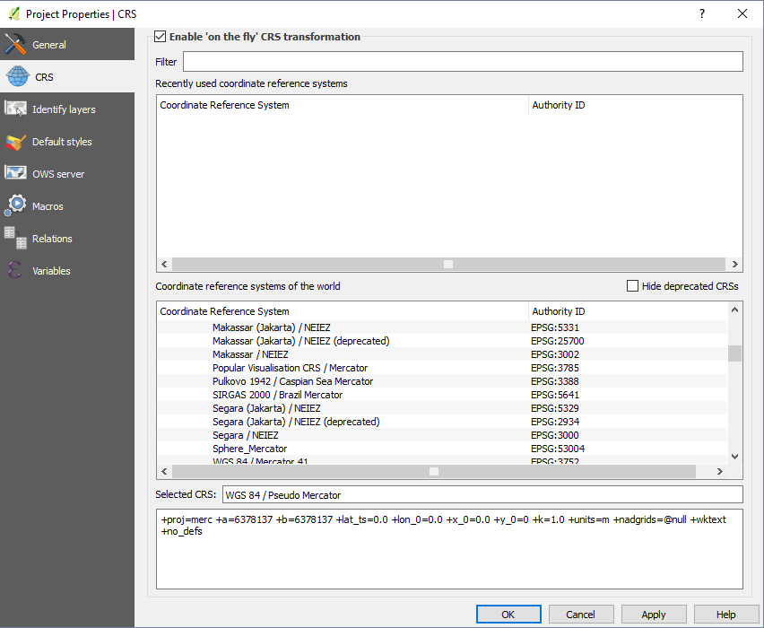

11. Great! Now we can see our map data on top of an aerial photograph of the earth. 
    Note that this is the same imagery provided by Microsoft Bing that you would load for editing in JOSM. 
    Try unchecking the box next to the layer **Kecamatan Sleman** so that you can see the area better. 
    Zoom in close to see detailed imagery with our street and railway layers displayed on top.

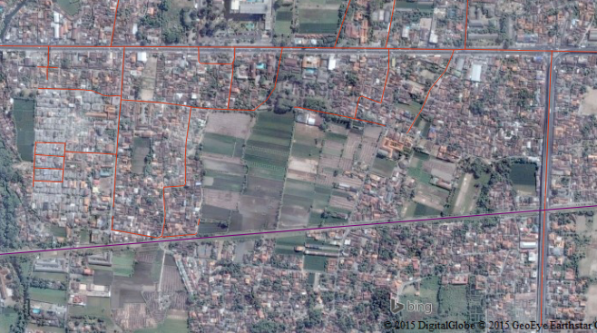

12. Remove the Bing Aerial layer by right-clicking it in the Layers panel and clicking **Remove**.

13. Try out other layers that are available to you from the **Web --> OpenLayers plugin** menu..

### 3.7.3 Install InaSAFE Plugin

Now, we are going to install InaSAFE plugin.

1.  Go to **Plugins Manage and install plugins** menu

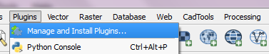

2.  Go to the Search box and type `“inasafe”`

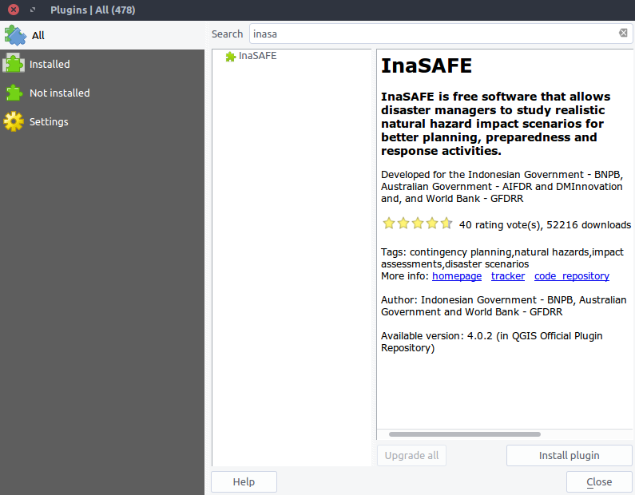

3.  Select InaSAFE and click **Install plugin** and wait for a moment until a pop-up notification showing that plugin has installed successfully.

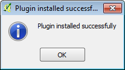

4.  Close the plugin manager window and we will learn about InaSAFE later in Chapter 8.

Now you already know basic QGIS from installation, understand QGIS layout, learning useful toolbar and basic operation in QGIS. 
You also already learn about how to install InaSAFE, a plugin that we will learn more in the last chapter of this module.

Go to next chapter --> <ch4-map-projection-basic>
