# Chapter 4: Map Projection Basics

**Learning Objectives**

-  Understand Coordinate Reference Systems (CRS)

-  Identify the CRS of a vector dataset

-  Doing “on the fly” reprojection

-  Save dataset with a different CRS

-  Georeference Digital Image

We’ve talked a little bit about Coordinate Reference Systems (CRSs) previously,
but haven’t covered it in depth. In this chapter, we’ll look more at what a CRS means practically,
and how it affects our work in QGIS.

## 4.1 Coordinate Reference System (CRS)

The CRS that all the data as well as the map itself are in right now is called WGS84.
This is a very common Geographic Coordinate System (GCS) for representing data.
But there’s a problem, as we will see.

1. Open the project `Chapter_4_Map Projection.qgs`, located in the `QGIS for Disaster Management/` folder

2. Zoom in to Indonesia by using the **Zoom In tool**.

3. Setting the scale in the Scale field, which is in the Status Bar along the bottom of the screen.
   While over Indonesia, set this value to 1:20000000 (one to twenty million).

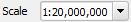

4. Now pan around the map while keeping an eye on the Scale field.

Notice that the scale is changing? That’s because you’re moving away from the one point that you zoomed into at 1:20000000,
which was at the center of your screen. All around that point, the scale is different.

To understand why, think about a globe of the Earth. It has lines running along it from North to South.
These longitude lines are far apart at the equator, but they meet at the poles.
In a GCS, you’re working on this sphere, but your screen is flat.
When you try to represent the sphere of the earth on a flat surface, it becomes distorted,
as if you took an orange peel and tried to flatten it.
What this means on a map is that the longitude lines stay equally far apart from each other,
even at the poles (where they are supposed to meet). 
This means that, as you travel away from the equator on your map,
the scale of the objects that you see gets larger and larger.
What this means for us, practically, is that there is no constant scale on our map!

To solve this, we’ll use a Projected Coordinate System (PCS) instead.
A PCS “projects” or converts the data in a way that makes allowance for the scale change and corrects it.
Therefore, to keep the scale constant, we should reproject our data to use a PCS.

!!! note
    **Projection** is the act of taking coordinates on a sphere (like the earth),
          and manipulating them so that they can be displayed on a flat surface.
    

4.2 “On the Fly” Reprojection
-----------------------------

Every QGIS project has a CRS, and each of the data layers have a CRS too.
Often these are the same. Your project may be in WGS84, and the layers too.
But sometimes you will add a layer that is not in the same CRS as the project,
and you need QGIS to convert it so that it can be displayed along with the rest of the data.
The term that we use for this is reprojecting *on the fly*.

1. To enable “on the fly” projection, click on the **CRS** Status button in
   the Status Bar along the bottom of the QGIS window:

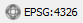

2. In the dialog that appears, check the box next to **Enable ‘on the fly’** CRS transformation.

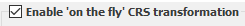

3. Type the `NSIDC` into the Filter field. One CRS **NSIDC EASE-Grid Global** will appear in the list below.

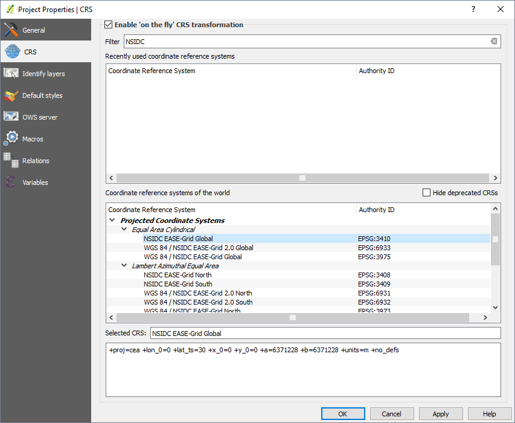

4. Click on it to select it, then click **OK**.

5. Notice how the shape of Indonesia changes. All projections work by changing the apparent shapes of objects on Earth.

6. **Zoom in** to a scale of 1:20000000 again, as before.

7. **Pan** around the map.

8. Notice how the scale stays the same!

!!! note
    'On the fly' reprojection is useful for combining datasets that are in different CRSes.
    

9. Deactivate “on the fly” reprojection again, by unchecking the box next to **Enable ‘on the fly’** CRS transformation.

10. Now let’s add another vector layer, located in `QGIS for Disaster Management/peta_dunia/Indonesia.shp`. What do you notice? The layer isn’t visible! But that’s easy to fix,right?

11. Right-click on the layer in the Layers list.

12. Select **Zoom to Layer Extent**.

OK, so now we see Indonesia... but where is the rest of the world?

It turns out that we can zoom between these two layers, but we can’t ever see them at the same time.
That’s because their Coordinate Reference Systems are so different.
The **continents** layer is in degrees, but the **Indonesia** layer is in meters.
In other words, one feature in the continents layer might be 8.5 degrees away from the equator,
but the same feature in the Indonesia layer might be 900000 meters away from the equator.

8.5 degrees and 900000 meters is about the same distance, but QGIS doesn’t know that!
One of our layers must be reprojected to match the other layer.

To correct this:

1. Switch **Enable ‘on the fly’** CRS transformation on again as before.

2. Zoom to the extents of the Indonesia dataset.

Now, because they’re made to project in the same CRS, the two dataset fit perfectly:

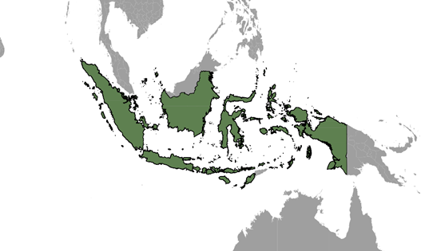

When combining data from different sources, it’s important to remember that they might not be in the same CRS.
'On the fly' reprojection helps you to display them together.

## 4.3 Dataset with different CRS

It’s great that QGIS can reproject layers on the fly so that we can work with them in the same project.
But this requires more time for our computer to reproject the layers,
and can slow down our work. For this, or for other reasons, we might want to be able to reproject a dataset,
and save it with the new projection.

Let’s reproject the **Indonesia** layer so that it is in the same CRS as the project.
To do this, we will need to export the data to a new file using a new projection.

1. Right-click on the **Indonesia** layer in the Layers list.

2.  Select **Save As...** in the menu that appears. You will be shown the **Save vector layer as...** dialog.

3. Click on the **Browse** button next to the Save as field.

4. Navigate to `QGIS for Disaster Management/peta_dunia/` and specify the name of the new layer as `Indonesia_terproyeksi.shp`.

5. Leave the **Encoding** unchanged.

6. Change the value of the Layer CRS dropdown by clicking on **Select CRS** icon in the right panel.

7. A **Coordinate Reference System Selector** window will appear. Type `4326` in **Filter Box** 
    and select **WGS 84** in the bottom side of the window.

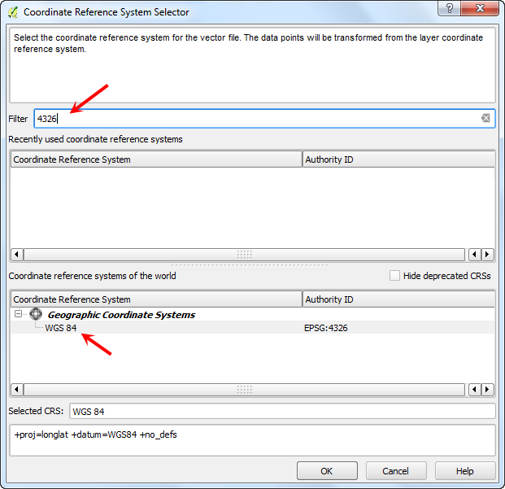

8. Click **OK**. You will back to **Save As…** window.

9. Check the box next to **Add saved file to map**.

10. The **Save vector layer as...** window now looks like this:

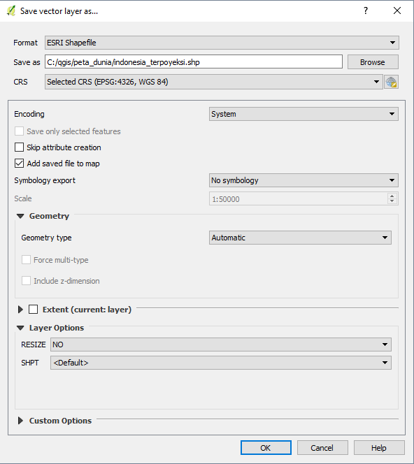

11. Click **OK** and after a minute, you should be presented with a notification above map canvas telling that the process is finished.

12. Now your new layer, **Indonesia\_terproyeksi**, will be shown in the layers panel. 
    If you turn off **on the fly** reprojection, this layer will still be shown correctly,
    because it has been reprojected into the same CRS as the project (and the **continents** layer).

## 4.4 Georeferencing Scanned Image

Georeference is the process of associating a physical map or raster image of a map with spatial locations
and may be applied to any kind of object or structure that can be related to a geographic location,
such as point of interest, roads, places, bridges, or buildings.
Georeferencing is crucial to enable aerial or satellite imagery and also raster images to be overlayed with other spatial data,
like vector data and raster data.

To georeference an image, we need to establish point with geographic coordinates in these point, known as control points.
This control point refer to actual position of objects on Earth.
These coordinates are obtained by doing field survey. 
For example, we need to georeference an aerial image and we know location an object in aerial image with exact location on Earth.
To georeference this, simply input the control points with coordinates that we know from field survey.
We need 4 control points or more to georeference the image.

Let’s start to georeference an image that we got from `Geospasial BNPB <http://geospasial.bnpb.go.id>`_.

1. Georeferencing in QGIS is done via the **Georeferencer GDAL** plugin. This is a core plugin - meaning
   it is already part of your QGIS Installation. You just need to enable it. Go to **Plugins --> Manage and Install Plugins…**
   and enable the Georeferencer GDAL plugin in the Installed tab.
   
2. Go to **Raster --> Georeferencer --> Georeferencer…**.

3. A new window will appear. Click **Open Raster** icon in upper left side of the window.

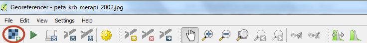

4. Select `QGIS for Disaster Management/Sleman/Merapi/peta_krb_merapi_2002.jpg` and click **Open**.

5. In Coordinate Reference System Selector type `4326` in filter box and select **WGS 84** as CRS.

6. An image will appear in Georeferencer Window.

7. You can use the **zoom/pan** controls in the toolbar to learn more about the map.

8. If you look closely, you will see coordinate grid with markings.
   Using this grid, you can determine the X and Y coordinates of the points where the grid intersect.
   Click on **Add Point** in the toolbar.

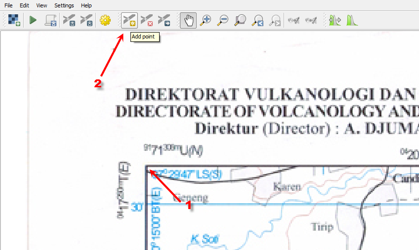

9. A new pop-up window will appear, enter the coordinates. 
    For Indonesia enter X for Bujur (BT) and Y for Lintang (LS). 
    Click **OK**. It can use decimal degree (dd,dd), projected coordinates/UTM (mmmm,mmm) and degree minutes seconds (dd mm ss,ss) format.
    **Don’t forget to put Negative ( - ) in Y/North value for area in the South part of equator**.

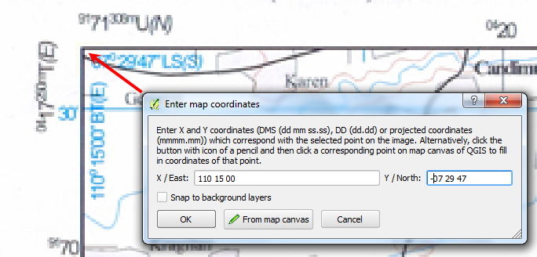

10. Notice that GCP table in the bottom of window has a row with detail of your first GCP.

11. Now, let’s add at least 4 GCPs that covers entire image. More GCP’s points will result to a more accurate image.

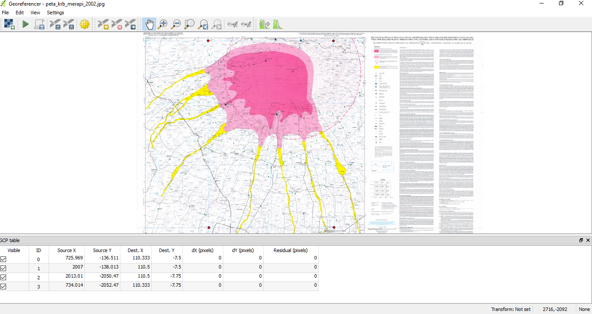

12. After inputting 4 or more points, click **Transformation Setting** in toolbar.

!!! note
    Right click the entry in **GCP Table** to delete the GCP Point
             or select **Delete Control Point** tool in toolbar above the image,
             then use it to click on the Control Point in either the GCP table or Workspace Window
    

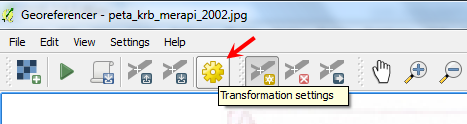

13. The Transformation Setting Window is displayed. Follow all setting like this:

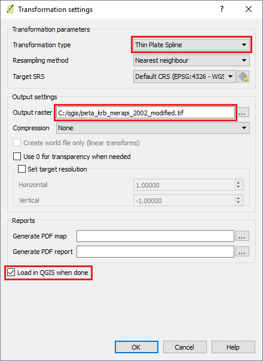

!!! note
    In QGIS there are several method s for transforming the image,
          these are linear, Helmert, the 1\ st, 2\ nd and 3\ rd order polynomials,
          and the thin plate spline. These different Transformation Methods interpret your Control Point in different ways,
          and control how the map is fitted and warped to your georeferenced base map.
    
          For best fit, the thin-plate spline or higher-number polynomial transformations are often best.
          Its look like a true rubber sheeting method, transforms the source Control Point exactly to the target Control Points,
          and optimize for local accuracy opposed to global accuracy.
    

14. To finish and export your georeferenced map, click the **Start Georeferencing** button
     in the **Main Toolbar** at the top of the QGIS Workspace.

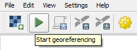

15. The Georeferencing is now complete. The georeferenced layer will be loaded in QGIS Map Canvas.

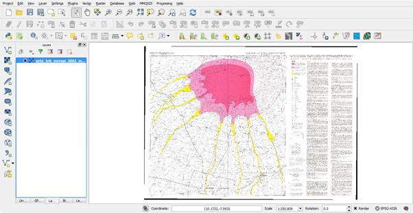

Knowing how to georeference is important when we want to digitize from a paper map or an image that is not already georeferenced.
Once the image is georeferenced like this, it can be used at the same digitization techniques that we will learn later.
In the next chapter, we will create vector shapefiles that can be used in QGIS and InaSAFE.

Go to next chapter --> <ch5-working-with-vector-data>
