# Chapter 6: Working with Raster Data

**Learning Objectives**

-  Load Raster Data
-  Change Raster Symbology
-  Terrain Analysis

Thus far we’ve worked mostly with vector data, which consists of features, and these features are themselves made up of points and lines. In this chapter we will learn about raster data.
Remember when you were editing OpenStreetMap in JOSM? The points, lines and shapes that you drew were vector data. But when you loaded Bing aerial imagery in the background, that was raster data. So what’s the difference?

Raster data essentially comes in the form of an image. It is made up of pixels, like a photograph, and a raster image will always be some number of pixels wide and some number of pixels high.
If you zoom in far enough on a raster image, it will start to become blurry, just as if you opened a photo on your computer and zoomed in very close. As we’ll see in this chapter, however, a raster image can mean more than just a photograph from the sky. Follow along and we’ll learn all about rasters!

## 6.1 Loading Raster Data

Not all raster data consist of aerial photographs. There are many other forms of raster data, and in many of those cases, it’s essential to symbolise the data so that it becomes properly visible and useful.
In this section we’ll add a new kind of raster and see how to change its symbology.

1. Click on the **Load Raster Layer** button:

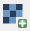

2. The Load Raster Layer dialog will open. Find the file named `popmap10_all.tif` in `QGSI for Disaster Management/Working with Raster` folder. Open it.

3. When it appears in the Layers Panel, right-click on it and click **Rename**. Give it the name *Indonesian Population*.

!!! note
    High resolution, contemporary data on human population distributions are a prerequisite for the accurate measurement of the impacts of population growth, for monitoring changes and for planning Interventions. The AsiaPop project was initiated in July 2011 with an aim of producing detailed and Freely-available population distribution maps for the whole of Asia.*
    

When it loads, you’ll notice that the new raster image appears as whole Indonesia’s Islands in grey colour.

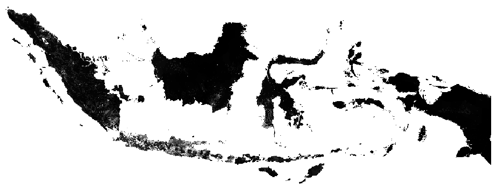

The layer appears grey (and doesn’t give us any information) because its symbology hasn’t been customised yet.
In the colour aerial photograph we loaded via *OpenLayer* Plugin, everything is already defined. But if you
load a raster image and it’s just a grey rectangle, then you know there’s no symbology for it yet. It still needs to be defined. That’s what we will do next.

## 6.2 Symbolise Raster Data

1. Open the **Layer Properties dialog** for the Population layer, which is now named *Indonesian Population*.

2. Switch to the **Style** tab. This shows the current symbology settings, and as we’ve seen, they don’t give us much information on the layer. Let’s make sure the layer has data in it.

3. Change the **Render type** to **Singleband pseudocolor**. Set colour to **YlOrBr** and change mode to **Equal Interval** with **6 Classes**. Click **Classify** to show 6 classes. As shown below:

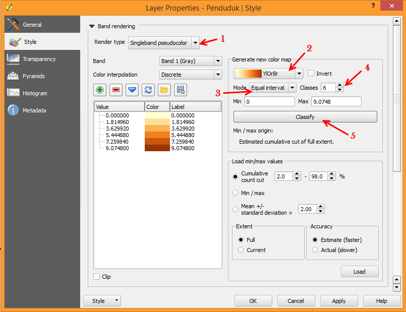

4. Click *OK*. The raster should look like this:

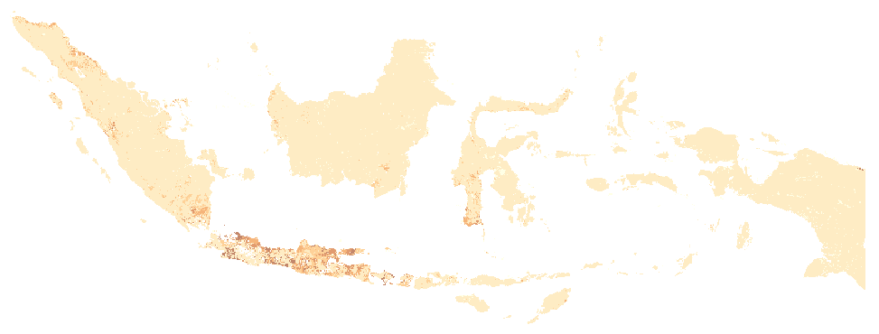

Good! This tell us that there is data in this layer. And by looking at it we can get an idea in Java Island, population number higher than other island in Indonesia.

Let’s stop for a minute and understand what is happening here. Remember that an image is made up of pixels, individual cells that contain a value, which is usually a colour value. For example, if you zoom in very closely on a photograph you can see those individual pixels, like this:

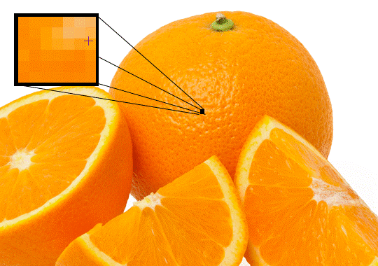

The value of each cell is saved in the file. Imagine the file being saved something like this, where each square is a pixel:

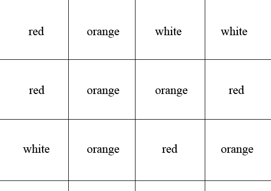

Of course the computer doesn’t understand words for colours. In fact the value of each cell would be a number, which the computer then associates with a certain colour. For our aerial image, this is already defined.
Since it is a normal image, it knows to associate the numbers for each pixel in the file with the common colours that we see every day. But this new raster image is different, because the values of each pixel don’t represent colours, but rather altitude, and QGIS doesn’t know automatically how to display it. Hence it shows every pixel in the image as grey, even if the values in each pixel are different.
When we change the symbology to Psuedocolor, we can see all the different pixel values shown with various colours.

It would be nice to represent our Indonesian Population layer as a greyscale spectrum, rather than a variety of bright colours. Next we will tell QGIS to symbolise the layer with colours in a spectrum, beginning at the lowest pixel value in the file and ending at the highest pixel value. In other words, if the pixel values looked like this:

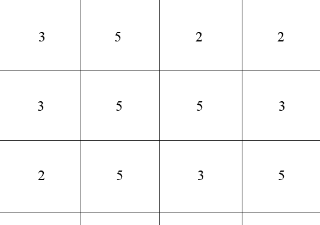

QGIS would create a spectrum equating numbers to colours like this:

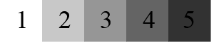

And render the image like this:

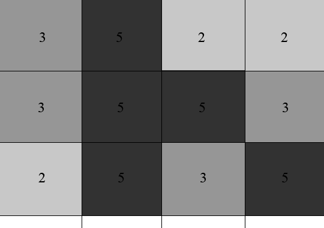

To do that, let’s start to symbolise Indonesia Population:

1. Open the **Layer Properties** Again.

2. Switch the render type back to **Singleband gray** (1).

3. Check the box next to **Min / max** (2).

4. Next to **Contrast enhancement** select **Stretch to MinMax** (3).

5. Under **Load min / max values**, select **Estimate (faster)**.

6. Click the **Load** button:

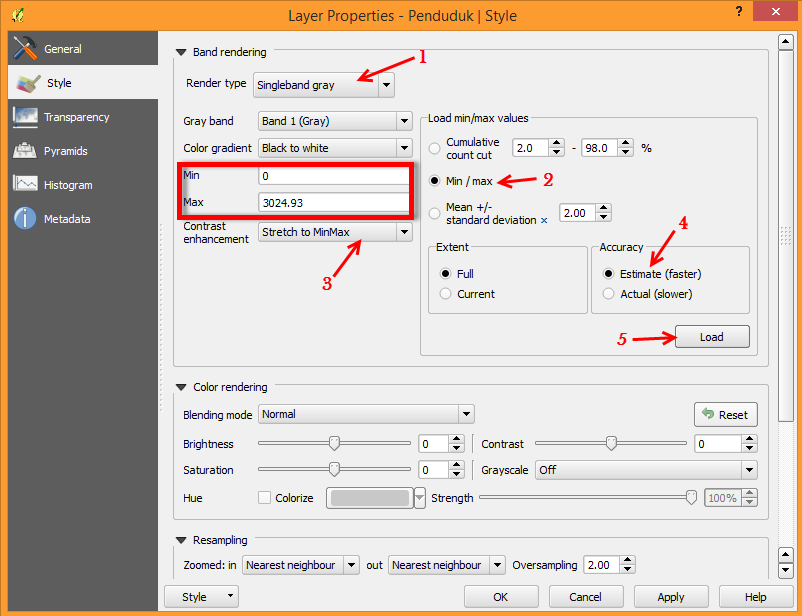

Notice how the custom Min and Max values have changed.
The lowest pixel value in this image file is 0 and the highest is about 3024.93. But what are the minimum and maximum values that should be used? The current values are those that just gave us a grey rectangle. Instead, we should
be using the minimum and maximum pixel values that are actually in the image.
You can determine those values easily by loading the minimum and maximum values of the raster.

1. Click *OK.* You should see the values of the raster properly displayed, with the darker colour representing small number of population in each pixel and the lighter one, high number of population in each pixel:

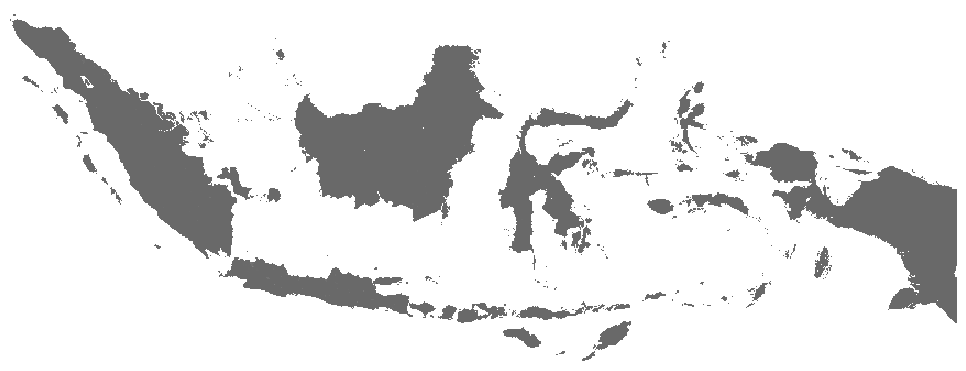

We’ve learned to do this the tricky way, but can we do it faster? Of course! Now that you understand what needs to be done, you’ll be glad to know that there’s a tool for doing all of this more easily.

1. Remove **Indonesian Population** from the Layers panel, by right-clicking it and clicking **Remove**

2. Load the raster image again, renaming it to *Indonesian Population* as before. It will be a grey rectangle again.

3. Enable the tool you’ll need by enabling **View → Toolbars → Raster** These icons will appear in the interface:

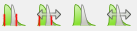

The button on the right will stretch the minimum and maximum values to give you the best contrast in the local area that you’re zoomed into. It’s useful for large datasets. The button on the left will stretch the minimum and maximum values to constant values across the whole image.

4. Click the right button labelled **(Stretch Histogram to Full Dataset)**. You’ll see the data is now correctly represented as before!

## 6.3 Terrain Analysis

Certain types of rasters allow you to gain more insight into the terrain that they represent. Digital Elevation Models (DEMs) are particularly useful in this regard. In this section we’ll do a little bit more with our DEM raster, in order to try to extract more information from it.

### 6.3.1 Calculating a hillshade

The DEM you have on your map right now does show you the elevation of the terrain, but it can sometimes seem a little abstract. It contains all the 3D elevation information about the terrain that you need, but it doesn’t really look 3-Dimensional.
To get a better look at the terrain, it is possible to calculate a hillshade, which is a raster that maps the terrain using light and shadow to create a 3D-looking image.

To work with DEMs, we will use the all-in-one DEM (Terrain models) analysis tool.

1. Open the file named `SRTM_Merapi.tif`, which is located in `QGIS for Disaster Management/Working with Raster` folder.

2. When it appears in the **Layer** panel, rename it to **DEM**.

3. Click **Stretch Histogram to Full Dataset** button.

4. Go to **Raster → Analysis → DEM (Terrain Models)…**

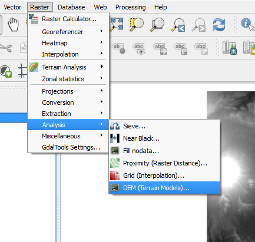

5. In the dialog that appears, ensure that the input file is the **DEM**
   layer.

6. Set the output file to **hillshade.tif** in the directory **Merapi/SRTM/**.

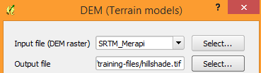

7. Check the box next to **Load into canvas** when finished.

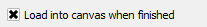

8. Leave all the other option unchanged.

9. Click **OK** to generate the hillshade.

10. When the processing is complete. Click **OK** on the notification.

11. Click **Close** in the dialog.

There should now be a new layer called *hillshade* that looks like this:

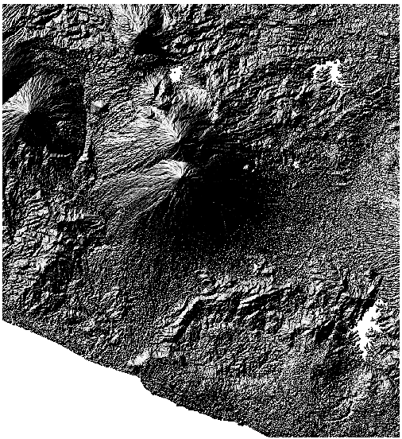

This looks more Three-Dimensional, but can we improve on this? When you open **DEM (Terrain Models)** tools, you will notice in the Mode Options for hillshade there’re *Azimuth of the light* and *Altitude of the light*.

**Azimuth of the light** defines in which direction the sun is, whereas 0° represent north, east is 90°, south is 180° and west is 270°.
While **Altitude of the light** is the angle between the horizon and the centre of the sun’s disc.

On its own, the hillshade looks like a plaster cast. It will look better if we can combine it with our more colourful DEM. We can do this by making the hillshade layer an overlay.

### 6.3.2 Using a hillshade as an overlay

Hillshade can provide very useful information about the sunlight at a given time of day. But it can also be used for aesthetic purposes, to make the map look better. The key to this is setting the hillshade to being mostly transparent.

1. Change the symbology of the original **DEM** layer to use the **Pseudocolor** scheme.

2. Click and drag the **DEM** layer beneath the **hillshade** layer in the Layers panel.

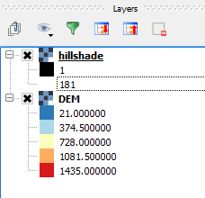

3. Ensure that **Control rendering order** is checked.

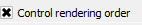

4. Now we will make the hillshade layer somewhat transparent. Open its **Layer Properties** and go to the **Transparency** tab.

5. Set the **Global transparency** to 50%:

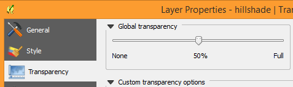

6. Click **OK** in the Layer Properties dialog. You should get a result similar to this:

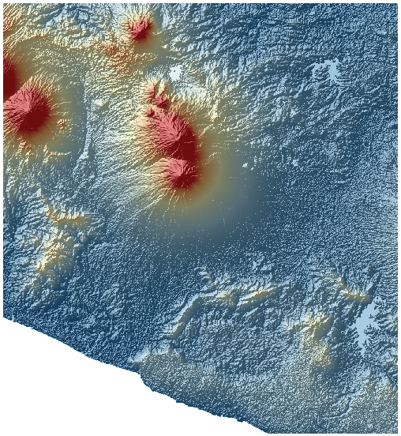

Using a hillshade in this way, it’s possible to enhance the topography of the landscape. If the effect doesn’t seem strong enough to you, you can change the transparency of the hillshade layer; but of course, the brighter the hillshade becomes, the dimmer the colours behind it will be. You will need to find a balance that works for you.

Go to next chapter --> <ch7-using-map-composer>
