# Chapter 7: Using Map Composer

**Learning Objectives**

-  Arrange map layout
-  Add new map
-  Add title to a map
-  Add graphic and numeric scales
-  Add grid to a map
-  Add an inset
-  Customise the content of the legend
-  Export a map to different formats (pdf, jpeg, svg)

A map is a means to communicate information (as well as new ideas) tothe audience. We use symbology to convey the contents of our data so it can be easily understood.
When we create a map layout, we go one step further - we present your map so that it becomes a means of information.

No matter what media we plan to distribute your map by (whether it’s printed or sent over the internet), we must pay attention to how you compose your map elements in the layout.
In this module we will discuss the presentation of printed maps, and create our very own.

## 7.1 The Map Composer

The QGIS Map Composer allows you to prepare it for printing. Apart from the map, you are able to add additional information such as images, labels, legends, and scalebars.

-  Let’s start with some data in the Sleman regency that has already been symbolised. Open the project named `Chapter_7_Map Composer.qgs` in the `QGIS for Disaster Management` directory.

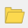

This map shows some familiar layers from the previous module. We have the roads and vegetation of Sleman, along with the three impact zones from a Merapi eruption model.

Let’s see how we can use Map Composer to adjust the layout and prepare this map for printing.

-  Go to **Project ‣ New Print Composer**. Then, give an unique title name for your layout, for example: `Sleman`. Click **OK**, then a new window will load that looks like this:

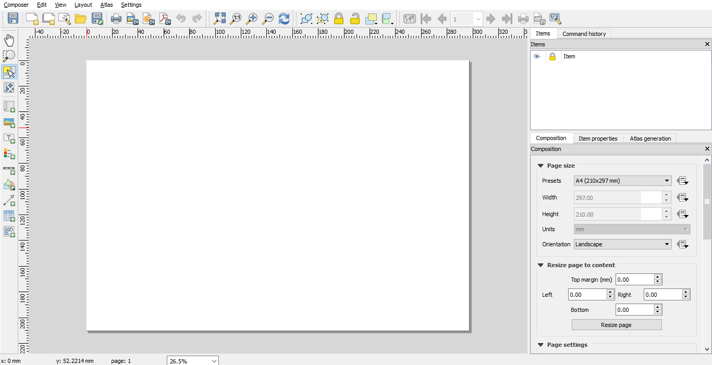

This is the window where you can compose the layout of a map that you want to print. The blank white area is your “canvas”.It is a model of the paper you are going to print out. 
You can put various elements onto this canvas, such as your map (obviously), a title, scalebar, and legend. These are elements commonly used on printed maps.

Take a look at the right panel. In Composition tab, you change paper size, number of pages, and quality of output.

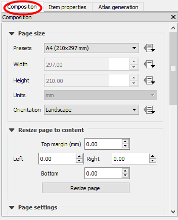

Take a look at the icons on the left of the window. We will use some of these as we lay our map out, so here’s an overview of what they do:

+------------------------------------------+--------------------------------------------------------------+
| .. image:: /static/training/qgis/7_004.* | **Add New Map** will add a map element. This is what we will |
|                                          | use to add the map from our project into our print layout. It|
|                                          | should be noted, however, that if we change the map in our   |
|                                          | QGIS project, it will not update the same map that we have   |
|                                          | added to our print composer, as we shall see later.          |
+------------------------------------------+--------------------------------------------------------------+
| .. image:: /static/training/qgis/7_005.* | **Add Image** allows us to add a picture. You can add        |
|                                          | a company or organisational logo, or simply display images   |
|                                          | from a particular location. You can also add an image of     |
|                                          | a compass (to point North).                                  |
+------------------------------------------+--------------------------------------------------------------+
| .. image:: /static/training/qgis/7_006.* | **Add New Label** is used for adding text to the layout,     |
|                                          | such as titles or other information.                         |
+------------------------------------------+--------------------------------------------------------------+
| .. image:: /static/training/qgis/7_007.* | **Add New Legend** is for adding a legend,                   |
|                                          | which will conform to the active layer in the QGIS window.   |
+------------------------------------------+--------------------------------------------------------------+
| .. image:: /static/training/qgis/7_008.* | **Add New Scalebar** is used to add a scale to the layout.   |
+------------------------------------------+--------------------------------------------------------------+
| .. image:: /static/training/qgis/7_009.* | **Add Ellipse/Triangle/Rectangle** is used to add            |
|                                          | one of these geometric shapes. For example,                  |
|                                          | this might be used to indicate special areas or              |
|                                          | highlight things on the map.                                 |
+------------------------------------------+--------------------------------------------------------------+
| .. image:: /static/training/qgis/7_010.* | **Add Arrow** is used to draw an arrow on the map layout.    |
+------------------------------------------+--------------------------------------------------------------+
| .. image:: /static/training/qgis/7_011.* | **Select / Move Item** allows us to choose and move          |
|                                          | the elements that are in the map layout.                     |
|                                          | With this tool selected, you can right-click on              |
|                                          | an element to lock its position.                             |
+------------------------------------------+--------------------------------------------------------------+

## 7.2 Adding a New Map

1. In the Print Composer window, click on the **Add new map** button.

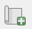

2. Next, click and drag your mouse across the canvas, creating a box.
    Your map layout should look similar to this when you are done:

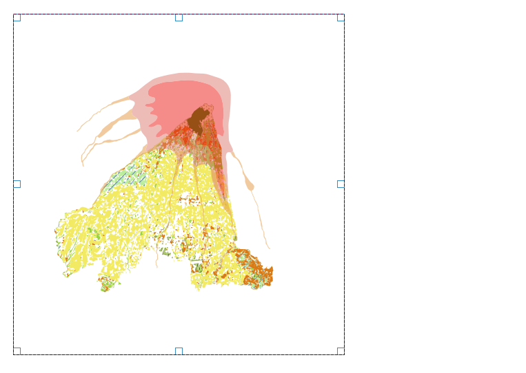

3. If you are not happy with the placement of your map, you can drag the corners to change the size, or drag the entire element around the canvas.

4. Once you are happy set the scale of your map by going to the **Item Properties** tab on the right panel.

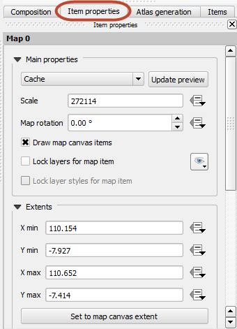

5. Edit the Scale and press `Enter`. You’ll see that the scale (zoom level) of the map element changes. A scale of about 200000 should be good for this project.

6. Add a frame clicking the box next to **Frame**. Configure the frame color and border thickness.

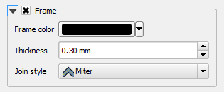

.. note :: When you change the scale some parts of your map may become invisible. Click on the **Move item content** button and drag the map so that it is all visible.

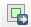

## 7.3 Adding a Title

Now we’ve got the most important thing added to our map layout - the map! But let’s add some additional elements to make it more informative.

1. Let’s add a title to our map. Click on the **Add new label** button.

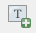

2. Adjust the size of the element. We will edit the text and the text properties in the panel on the right.

3. Click the **Font** button and change the text size to 18 and make it bold. Change the aligment to **Center**. Lastly, add the following text, or create your own:

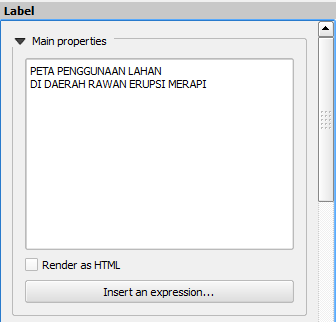

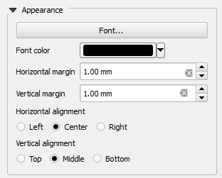

Your map layout should now look similar to this:

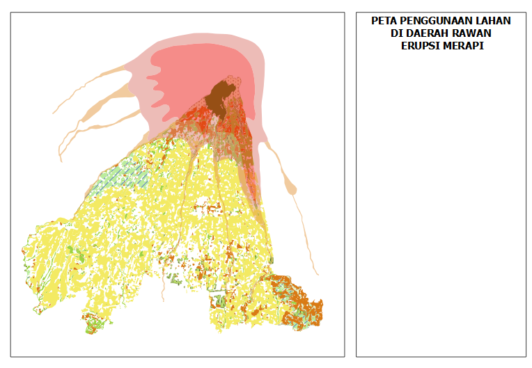

## 7.4 Adding a Scale Bar

Let’s add a scale bar, so that anyone who looks at our map will have an idea what size area this map shows.

1. Click on the **Add scale bar** button.

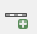

2. Draw the new scalebar element on your map. A good location for it is in the lower left corner of your map layout.

3. Next we need adjust the scalebar options. Since our project is in a PCS (Projected Coordinate System), our measurements are in meters. Enter the following values in the scalebar options:

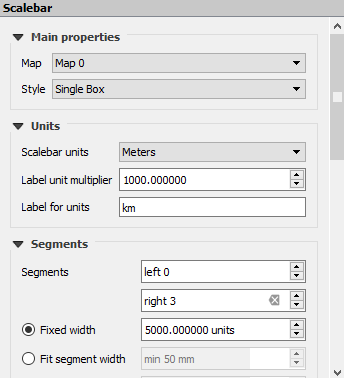

This should result in a scalebar that looks like this:

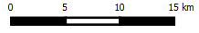

## 7.5 Creating a Grid

Now let’s create a grid for our map.

1. Choose the **Select** tool and click on the map.

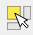

2. In the panel on the right you should see the word **Grid**. Click on it.

3. Click on the box + and enter the following values:

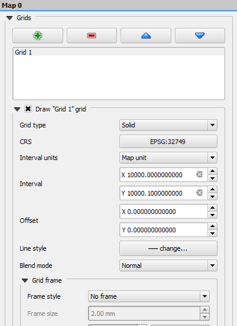

.. note :: We used coordinate reference systems with UTM (metre) on the project QGIS and all map layers.

4. Scrool down **Item Properties** dialog and Check the box next to **Draw Coordinates** and enter the following values:

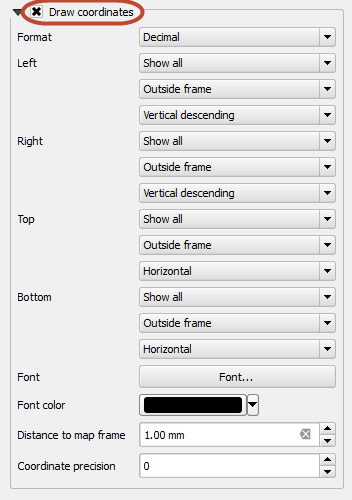

5. Your map should now have a grid appear over it, which will look something like this:

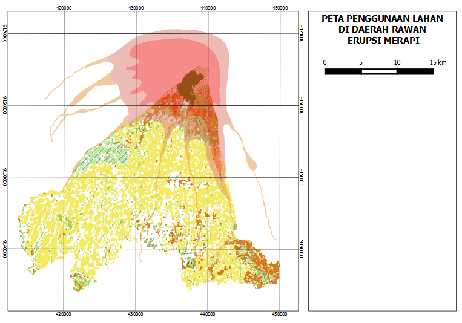

### Tips:

1. Play around a little bit with coordinate format. You can change decimal degree as the coordinate fromat or change it into Degree Minute format (DD MM) or Degree Minute Second (DD MM SS).

2. You can also adjust the coordinate placement. You can place the text inside or outside the frame, and make the orientation either vertical or horizontal.

3. Change the font type and font size by clicking **Font** in the panel.

## 7.6 Overview Inset

Next, let’s add an inset that gives viewers of our map a little more information about what they are looking at.

1. Click on the Map and go to **Item** tab.

2. Check the box next to Map 0 item to lock the item.

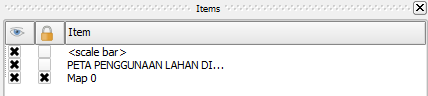

3. Minimize the Print Composer and go back into QGIS.

4. Add the layer **Indonesia.shp**, which is located in **qgis/peta\_dunia**. Cllick **Zoom Full**.

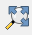

The new layer will load.

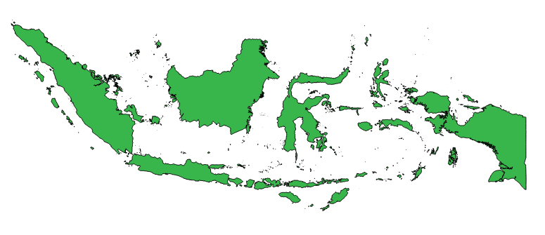

5. Return to the Map Composer and create a new map with the **Add new map** button.

6. Draw a small box on the right side of your map layout.

7. The current view of your QGIS project will appear in the new map element (but notice that the old map element doesn’t change. It’s because we locked the Map 0 in **Item** tab). 
Add a frame for the inset, so it will look like this:

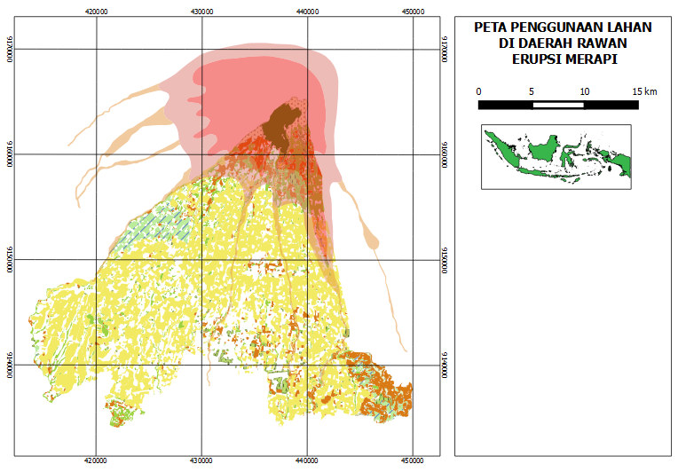

## 7.7 Adding a Legend

Now let’s add a legend so that viewers of our map will know what our symbology represents.

1. Click on the **Add legend** button.

2. Draw a box in the remaining empty space on your map layout. You will see a legend with symbologies shown in a list.

3. In the panel on the right, click on **Legend items**. Uncheck **Auto update** and use the edit button to change the names on the legend. Use the `+` and `-` buttons to add or remove items from the legend.
Choose which elements are important to include.

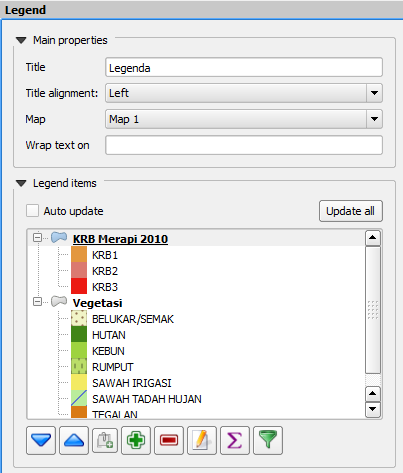

4.  Our legend look like this:

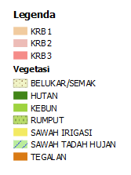

When you are finished, your map layout should look similiar to this:

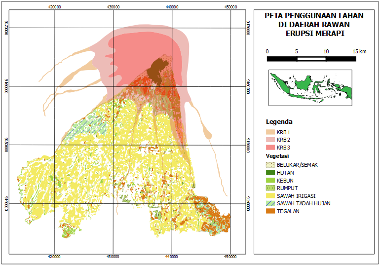

.. note :: For save your map composer that you created, you can click on the **Composer > Save Project**.So if you open the project QGIS and you want use map composer that you saved, click on **Project > Print Composer > My Layout 1**

## 7.8 Printing the Map

1. Lastly, you can print your map. Simply click the **Print** button and follow the dialog.

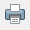

2. You may also save the map as PNG image.

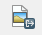

3. Additionally you can save the map as a PDF, which you can easily send over email or print later when you have a chance.

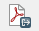

Go to next chapter --> <ch8-using-inasafe>
