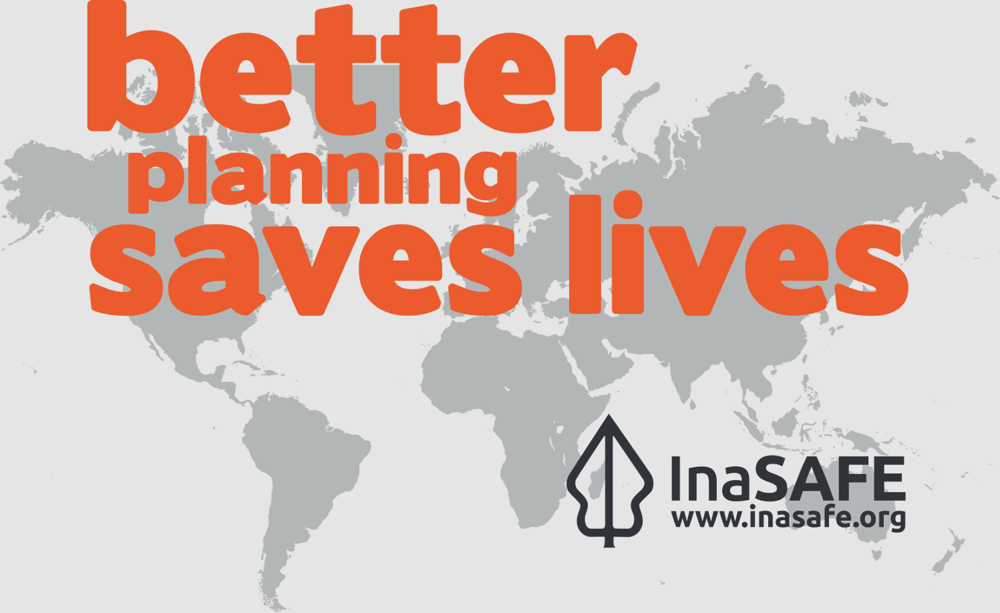
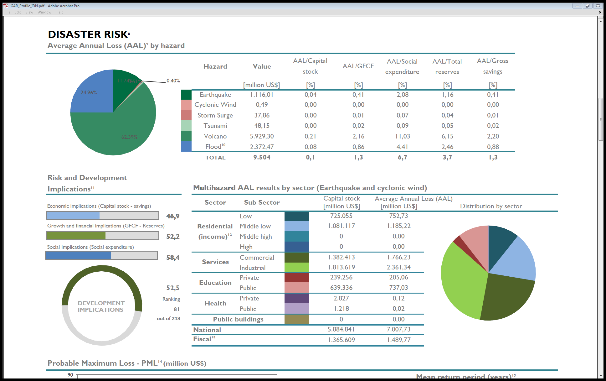
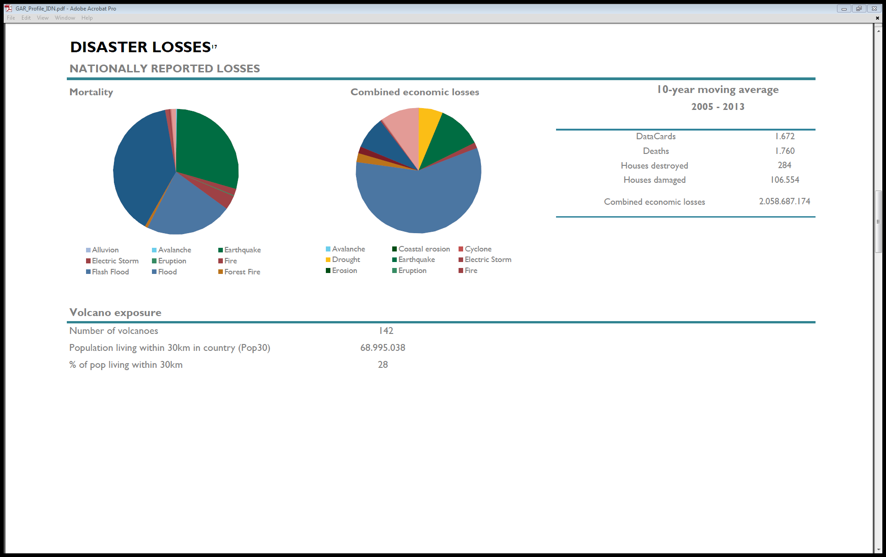

# Introducing InaSAFE

In this section we will introduce InaSAFE and provide some background on
the InaSAFE project.

## About the InaSAFE project

The InaSAFE project (http://inasafe.org) was started in order to
provide a tool for disaster managers who want to understand what the potential
impacts of a disaster will be. Initially the focus of activity was in
Indonesia - a country that is highly vulnerable to different disasters
including flood, tsunami, volcano, earthquakes, as well as other localised
disasters such as landslides, wildfire and so on. InaSAFE has since been
adopted for use in many other countries - it is not 'Indonesia specific'.

The underlying goal of InaSAFE is to encourage and facilitate better planning
for disasters - our slogan is **"better planning saves lives"**.

Each country in the world faces its own unique challenges. According to the
"Global Assessment Report for Disaster Risk Reduction (GAR)" for Indonesia the
chief concerns are volcanoes and floods - other countries will face
different challenges.

Key disaster risks for Indonesia - Image courtesy
`<http://www.preventionweb.net/english/hyogo/gar/2015/en/profiles/GAR_Profile_IDN.pdf>`_

Losses resulting from disasters in Indonesia - Image courtesy
`<http://www.preventionweb.net/english/hyogo/gar/2015/en/profiles/GAR_Profile_IDN.pdf>`_

In the InaSAFE project we strive to provide a tool that will enhance the
abilities of disaster managers to prepare for disasters and to reduce the
impact of those disasters on the local population and infrastructure.

### Open source

From the beginning, InaSAFE has been an open source project (GPL license).
This means there are no licensing fees, the software can be freely copied and
shared with anyone, and the source codes used to create the software are
freely available which means that anyone with a little technical knowledge
can contribute to the project. Being an Open Source project is important for
us because we want as many people as possible to be able to use and improve
the software. If 'better planning saves lives', having a tool that can be used
by everyone to do better planning makes sense, right?

### Open data

A key driving force in the ability to use tools such as InaSAFE is
open access to relevant, up-to-date and well maintained geospatial data.
Without roads, buildings, administrative areas, flood and population data
etc., a tool like InaSAFE would be impossible to use.
OpenStreetMap.org, WorldPop and many government and non-government agencies
around the world have been leading the effort to make such datasets available.
We cannot emphasise enough the importance of government in taking a lead role
in making their data freely available so that it can be used for the benefit
of their citizens.

### Watch the InaSAFE promotional movie

If you want to know more you can watch the promotional movie.
`<http://data.inasafe.org/Movies/InaSAFE_Promo_EN.mp4>`_
