# Run Intermediate InaSAFE

## Introduction

In `Run Basic InaSAFE <http://docs.inasafe.org/en/training/socialisation/run_basic_inasafe.html>`__ we learned how to run a flood analysis on
population and buildings, adjust the flood impact default settings and analyse
impact summary report, and change analysis threshold. We also
learned how to save our work and generate a pdf of the analysis results.
In this exercise we will learn more techniques such as how to run
InaSAFE with aggregation data to produce reports broken down by districts or regions. We
will also learn how to download data using the OpenStreetMap downloader and
how to run InaSAFE analysis on the downloaded building polygons and roads.
Last but not least, we will learn how to define the analysis area.

## Learning Objective

To improve the participant’s understanding of additional InaSAFE function and
features. By the end of this exercise, participants will be able to:

- Define keywords using the InaSAFE keyword wizard

- Run InaSAFE with aggregation data

- Use the OpenStreetMap Downloader to download data for InaSAFE

- Set the InaSAFE analysis area using the InaSAFE analysis area tool.

## Data for this exercise

The data for this exercise are available in Run Intermediate InaSAFE.zip which can be downloaded from `InaSAFE Training Data <http://data.inasafe.org/Socialisation%20Training/>`__. We will use
the following data:

1. Jakarta Flood 18113 WGS84

2. Jakarta District Boundary WGS84

3. Jakarta Subdistrict Boundary WGS84

4. Jakarta Population WGS84

## Exercise

### 1. Running InaSAFE for Population Data

#### A. Add and symbolise vector data

Click **Open** and select `DKI Jakarta Intermediate.qgs`.
There is a notification to save the current project, choose
whether to save your current work or discard your current work. Once `DKI_Jakarta_Intermediate` is opened, you will see the following:

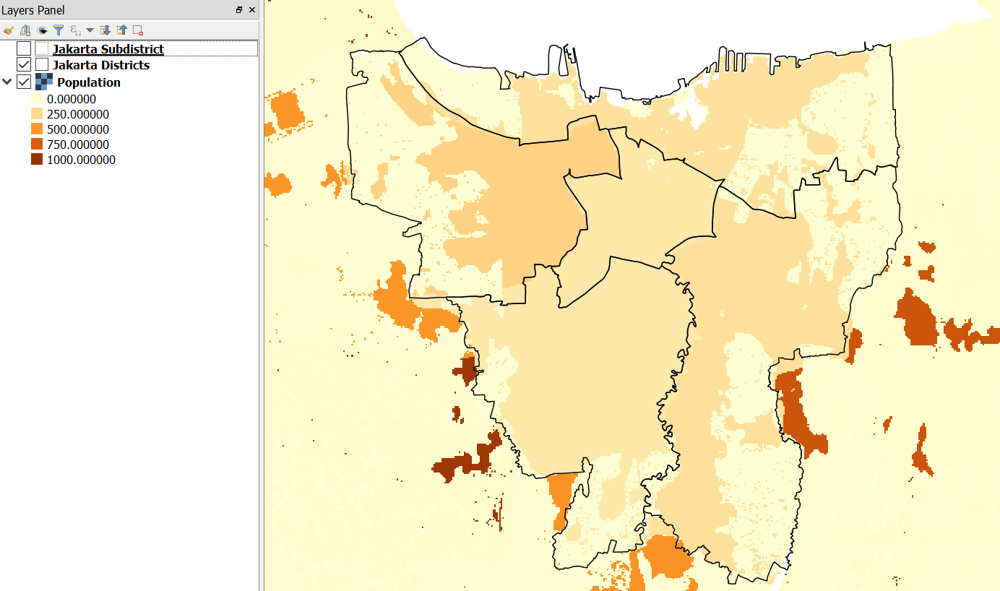

Next, add `Jakarta Flood 18113 WGS84` data from `Run Intermediate InaSAFE > DKI Jakarta > 01 Hazard Data`. This is the flood hazard data
for Jakarta from an actual flood event. During Jakarta floods in January
2013, the provincial disaster manager collected information about the flood,
including the location of flooded areas by sub-village boundary
(see more about this data at datasets.)

Let us symbolise this layer so that it shows only affected areas (if you
forget how to symbolise, you can go to introduction_to_qgis.)
The layer should look like this:

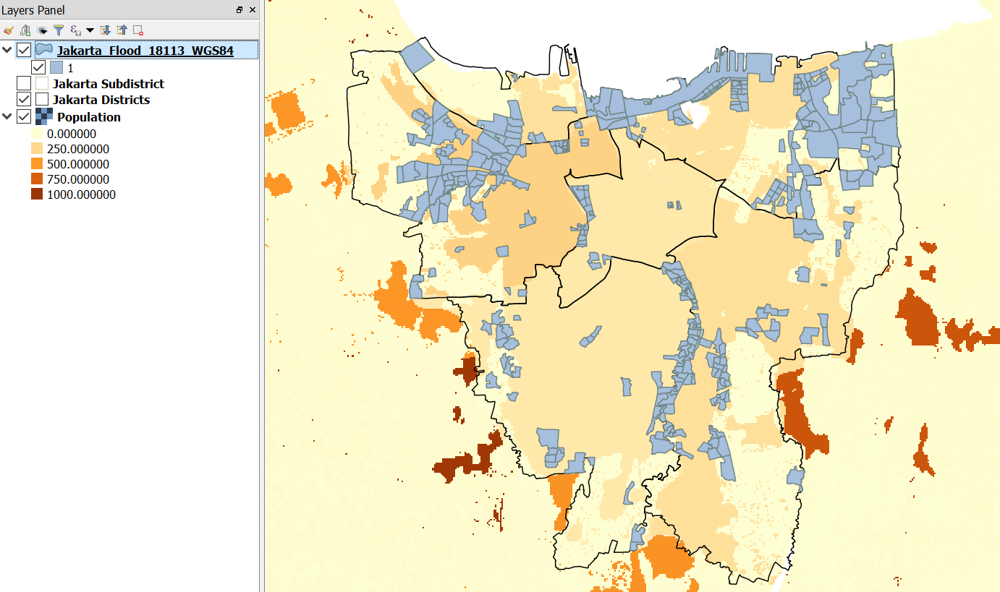

Using this layer, we will be able to see which area in Jakarta are categorized as
flooded/affected area by analysing the data using InaSAFE.
On the InaSAFE Dock, you will notice that the hazard is not
there and only exposure data (population) is visible, even
though you already turned ON the data layer.

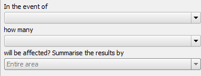

Do you know why InaSAFE did not display the Jakarta Flood Vector Hazard data on the dock?
The answer will be provided in the next section.

#### B. Define keyword for hazard data

InaSAFE need a keyword to determine what type of data the user
provide for analysis (hazard data, exposure data or aggregation data).
If the data provided does not have a keyword, it will show a warning
message “Layer Keyword Missing” in the InaSAFE Dock. Try selecting **Jakarta_Flood_18113_WGS84** layer and look at the InaSAFE dock, You will see
the following:

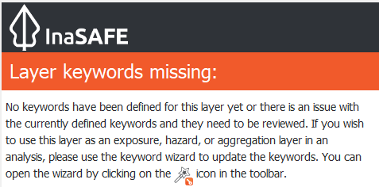

As you can see from the picture above, this layer keywords are missing
and we need to open the keyword wizard to solve this problem. The
keywords wizard will take you through a step-by-step process of
assigning keywords to your data.

Select **Jakarta_Flood_18113_WGS84** layer and click **Keyword Creation Wizard**.
A window will appear and follow the steps
provided by the **Keyword Creation Wizard.** If you get stuck, you can follow
the diagram below to understand the steps and the choices you will be
offered.

#### Steps in the Keyword Creation Wizard

Starting at the top of the diagram and working down; in the first step
you will choose if your data are hazard, exposure or aggregation data.
Your choice will determine the next options offered. 
You can always go back and change things later.

If you choose Hazard or Exposure, you will need to select the type of
hazard or exposure. Next, you will choose whether the layer mode
is continuous or classified (if you forget what Continuous
or Classified means, you can reference the `Key Concept of Disaster Management
section <http://docs.inasafe.org/en/training/socialisation/inasafe_concepts.html>`__).
Both Hazard and Exposure types have the same step after you define the
layer mode: defining which unit or attribute
represents the hazard.

The steps will be different for aggregation data. After you define the
data as aggregation data, you will select the attribute to represent
the names of aggregation areas. After you select it, you will be asked
to define the population ratio. Finally, you will need to enter the
source of data and the name of your layer to be displayed in the
InaSAFE dock.

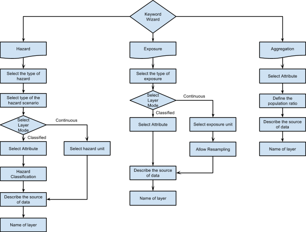

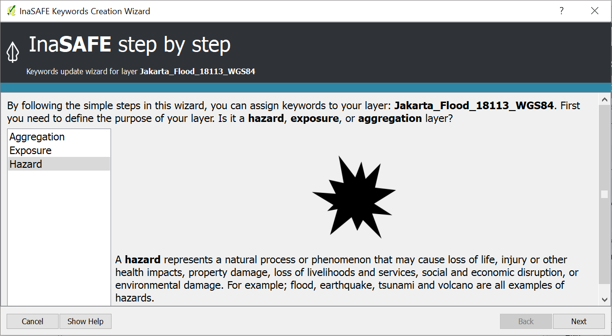

After you set the keyword using the Keyword Wizard, you can see in the
InaSAFE panel on the right side that the layer keyword has been set.
Verify that it looks like the image below? If it does not, you should go back and try to
define the keyword again.

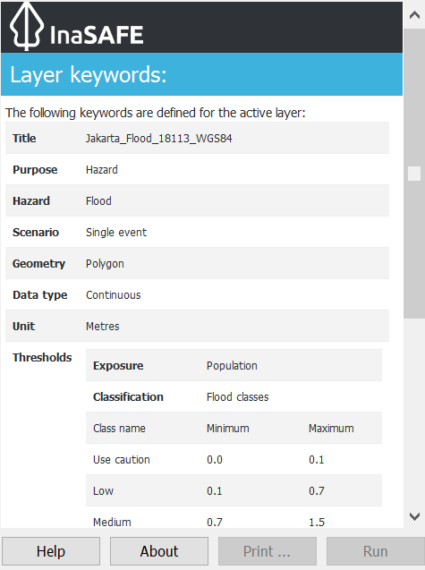

After you set the keyword to match the image above, the hazard data will
appear in the hazard panel of the InaSAFE Dock.

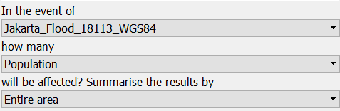

Now all the keyword data has been set and we can move into the next
section to run InaSAFE with population data.

#### C. Run InaSAFE for population with aggregation

We have seen the result of InaSAFE on buildings and populations with
raster hazard data. Now we will run InaSAFE analysis using
flood vector hazard data and raster population as exposure data. This time, however, we will use aggregated data. Using InaSAFE with aggregated data will help you to get
detailed result since the aggregated data can provide detailed
information on specific administrative (or other) area. InaSAFE allows us to add administrative data with specific boundaries that we can use to aggregate results.

To do this, look at the Layer List and make sure to turn ON the
**Jakarta District** layer. Next, take a look at the InaSAFE dock under the heading *Summarise the results by*.

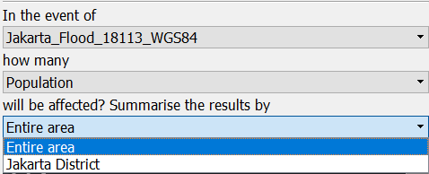

Why are we not able to see the **Jakarta District** layer that we just turned ON
before? Check the layer by selecting it on the Layer List. Did you see
the keyword? The reason why this layer did not appear in the InaSAFE Dock
is because it did not have keyword data defube. Go ahead and add a
keyword for **Jakarta District** using the **Keyword Creation Wizard**. For
your reference, refer to the keyword diagram as explained above.

Now you will able to select **Jakarta District** under 'Summarise the results by' in the InaSAFE
Dock. The InaSAFE Dock should look like this:

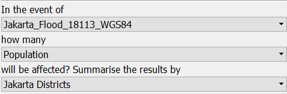

Click **Run** and wait until InaSAFE finishes analysing the data. A new
impact layer will be added to the Layer List. When you look at the result,
it looks the same as InaSAFE analysis result without aggregation, but if
you scroll down to the bottom you will see the detailed result. As
explained before, using aggregation will let you get detailed
information for a specific area or administration region.

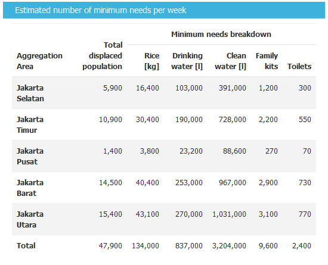

In the screenshot above, we see detailed impact results for each
district in Jakarta for the detailed minimum needs report. You can also use *jakarta subdistrict*
rather than using *jakarta_district* for aggregation if you want to get more detailed results.
Try running the analysis again using *jakarta subdistrict*. The
aggregation option in InaSAFE can also be applied for buildings and roads (in addition to population).
In the next exercise, we will learn to run InaSAFE for roads and buildings.

### 2. Running InaSAFE for roads and buildings

#### A. Download building polygons and roads with OpenStreetMap Downloader

We have completed running InaSAFE with population and vector hazard data. Now, we
will run InaSAFE with different type of vector exposure
data: roads and buildings polygons. We will obtain these dataset using
one of InaSAFE features, **OpenStreetMap Downloader**.
**OpenStreetMap Downloader** is a feature that enables downloading OpenStreetMap data
and directly loading it into QGIS. This feature requires an internet
connection as it fetches the data via a web service. Once downloaded, the data
will be available as shapefiles and symbolised neatly (more information
at `OpenStreetMap Downloader
page <http://docs.inasafe.org/en/user-docs/application-help/openstreetmap_downloader.html>`__).

To use this feature for our next exercise, follow these steps:

1. **Zoom in** to any flooded area that you prefer.

2. Click the **OpenStreetMap Downloader** icon.

3. Select **Building Polygons** and **Roads** as the feature types to download.

4. Click **Drag on Map** to select the boundary box from which data will be downloaded.

5. Choose your output directory, where OSM data will be stored. Adding a file name prefix makes it easier to identify the data downloaded.

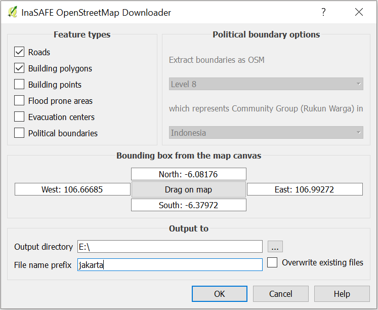

6. Click **OK**.

It may take a while to download all the data in the given area based on
how big the area is (generally dataset at city level and below should
work well). After you download the data, a new layer will appear in the
Layer List. The amount of data available depends on the OpenStreetMap
data available in the downloaded region. If you want to get more data in
your area, you can participate in OpenStreetMap and start map the area.

Since the data already downloaded, we are ready to run InaSAFE analysis.
But can InaSAFE run the data for only the small part of the whole hazard
data? We will find the answer in the next section.

#### B. Define your custom analysis area

InaSAFE has a feature that allows you specify exactly
which area should be used for your analysis. If you
have exposure data that is not the same size, you can use this
feature to define your own analysis area.

1. Click **Set Analysis Area** to show set analysis extent feature.

2. Select **Use intersection of hazard, exposure and this bounding box**.

3. Click **Drag on Map** to draw the bounding box around building polygons
   and roads.

4. Click **OK**

!!! note
    if you click Draw on Map, the window will be temporarily hidden
    so that you can drag a rectangle on the map. After you have finished
    dragging the rectangle, the window will reappear.
    

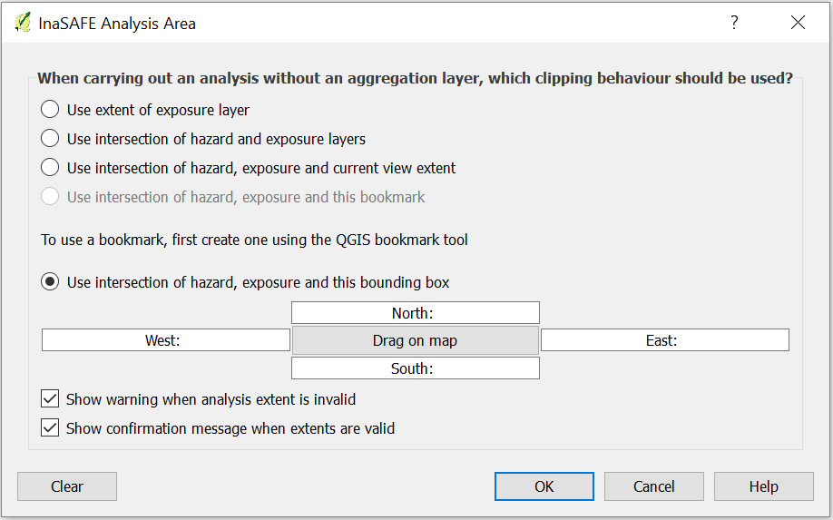

To verify that your analysis area has been successfully defined,
click **Toggle Scenario Outlines**. A green box will appear around your data.

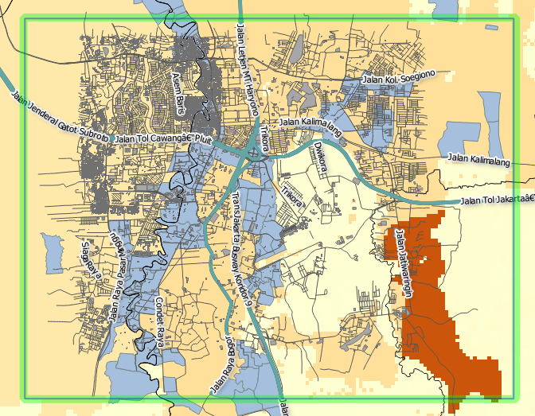

!!! note
    Using Toggle Scenario Outlines help you understand which area that InaSAFE
        will analyse. It is also an important step before running InaSAFE
        analysis because not all of the data you put in the Layer List will be
        automatically defined by InaSAFE.
    

Take a look at the InaSAFE panel dock to make sure building polygons and
roads have a keyword defined. If they do not you can define one using **InaSAFE Keyword Wizard**.
After the keyword has been already set, we are ready to run InaSAFE for building polygons and roads.

#### C. Run InaSAFE analysis for building polygons

Let us run analysis for building polygons first. Make sure you set the
InaSAFE dock as pictured below:

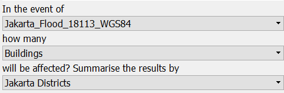

We will run InaSAFE for flood vector hazard and building polygons with data aggregated by Jakarta district
Click **Run** to begin InaSAFE analysis. After running, you
will find the impact result layer in Layer List.

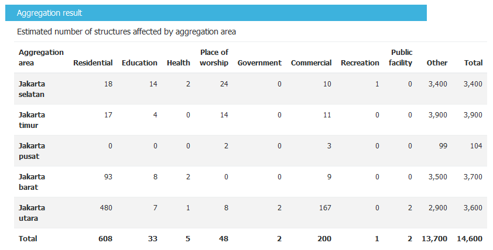

Look at the **Detailed building type report** (picture above) it shows that
five districts in Jakarta are affected by flood. Your results may vary
since it depend on the analysis area selected and
also the aggregation layer that you used for analysis.

InaSAFE did not separate the impact result into three categories as in
the Run Basic InaSAFE <run_basic_inasafe> because in the
previous exercise we used raster data containing information of flood depth in each pixel
yet in this exercise, the hazard data that we use only depicts affected
areas. Therefore, InaSAFE will calculate how many buildings are inside the affected
area but not level of impact on each building.

We just succeeded running InaSAFE on flood vector hazard with building
polygon. Next, we will run InaSAFE for roads. What are the results
that you expect to get when you run InaSAFE for roads?

#### D. Run InaSAFE for roads

In this last exercise, we will run InaSAFE on roads data that we previously downloaded
from OpenStreetMap. Make sure that you select roads as
exposure data in the InaSAFE dock, as shown in the screenshot below:

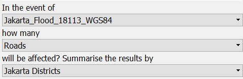

Click **Run** to start InaSAFE analysis. A new impact layer will be added
to your Layer List and in the map canvas you will see green roads as not
flooded and red as flooded. Select the **Flooded roads** layer to see
statistics from the InaSAFE analysis.

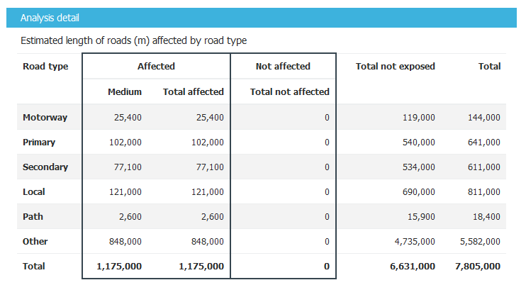

In this analysis, InaSAFE will generate statistics on how many roads are temporarily closed
in the affected area and also a breakdown of the result by road type.
If you are using aggregation, there will be detailed results for each aggregation.
In the action checklist, you will see several questions
that can be used for points of discussion related to road impact, and disaster logistics planning,
for example: *Which roads can be used to evacuate people or to distribute logistics?*

## Summary

In this exercise, you have learned how to run InaSAFE analysis with
different hazard data formats and with new type of exposure data. You have also
learned two fundamental steps to remember before you run InaSAFE:

First, you learned how to define a keyword for your data so it can be
analysed with InaSAFE. Without a keyword, InaSAFE will not recognize
your data, so you need to define it whether the data is hazard, exposure
or aggregation data. You can set the keyword
using the **Keyword Creation Wizard** feature.

Second, it is important to review the analysis area using *Toggle Scenario
Outline* before you run InaSAFE analysis. This is because, InaSAFE sometimes does
not automatically set the analysis area according to the intersection of hazard
and exposure data. If InaSAFE did not set the analysis area, you need to
define it manually using the **Set Analysis Area** feature.

In this exercise, you have learned how to download buildings and
roads data from OpenStreetMap using **OpenStreetMap Downloader**. With
this feature you can define the size of the area
and what type of data you want to download. The availability of the data
depends on how complete the data are in OpenStreetMap.

In the next section, you will learn how to run InaSAFE with other type
of hazard data such as tsunami, earthquake, volcano and generic data.
