# Other Hazards

## Introduction

InaSAFE was designed to predict the result of a disaster by giving us the potential impact on buildings, populations and roads based on specific scenarios.
From previous exercises, we have learned how to use Basic and Intermediate InaSAFE functionality.
We also learned about using tools in InaSAFE such as define keywords, configure minimum needs and area analysis,
using aggregation as well as many others.

In previous exercises, we used the "flooding in Jakarta" scenario and related data to learn InaSAFE functionality.
In addition to floods, InaSAFE impact analyses can be run for many hazard types including earthquakes, tsunamis and volcanos.
In this exercise, we will explore and learn to run other hazard scenarios in InaSAFE using InaSAFE dock and InaSAFE Function Centric Wizard.
Last but not least, we will also use the Generic Impact Function.

## Learning objectives:

To improve the participant’s understanding of how to use InaSAFE to run impact analyses for hazards other than floods.
By the end of this exercise, participants will be able to:

- Run InaSAFE with other hazards such as Earthquakes, Tsunamis and Volcanos;

- Be able to read metadata and assign keywords to hazard data;

- Be able to use the InaSAFE dock and the InaSAFE Function Centric Wizard; and

- Be able to use the Generic Impact Function and understand how to use it to work with their own data.

## Data for This Exercise:

The data used for this exercise is the same as that used in previous exercises. The data can be downloaded from InaSAFE `Training Data Packages <http://data.inasafe.org/Socialisation%20Training/>`__
Once the data has been downloaded, we will use the following QGIS project file and spatial data:

- Padang.qgs

- Maumere.qgs

- Nagekeo.qgs

- Padang_village_boundary_WGS84.shp

- West_Sumatera_Population_WGS84.shp

- Padang_EQ_2009_WGS84.tif

- Maumere_Tsunami_WGS84.tif

- Maumere_Buildings_WGS84.shp

- Sikka_Village_Boundary_WGS84.shp

- Sinabung_Hazard_Map_2015_WGS84.shp

- Sinabung_buildings_WGS84.shp

- NGK_Landslide_Vulnerability_WGS84.shp

- NGK_Buildings_WGS84.shp

- NGK_Population_WGS84.tif

- NGK_Villages_BPS_WGS84.shp

## 1. Run InaSAFE for Earthquake

### 1.1 Run InaSAFE for Building

#### a. Open Project

Indonesia’s location on the edges of the Pacific, Eurasian, and Australian tectonic plates makes it not only a site of numerous volcanoes but also frequent earthquakes.
The hazard layer we are going to use for this example has been provided by Badan Geologi and AIFDR, Australian Government and describes the shaking or Modified Mercalli Intensity (MMI) Scale.

This particular scenario is a modelled version of the 2009 Padang earthquake. Please open QGIS project file `Padang.qgs` from the `InSAFE Training Data > West Sumatera` folder. Once opened, you will see the below :

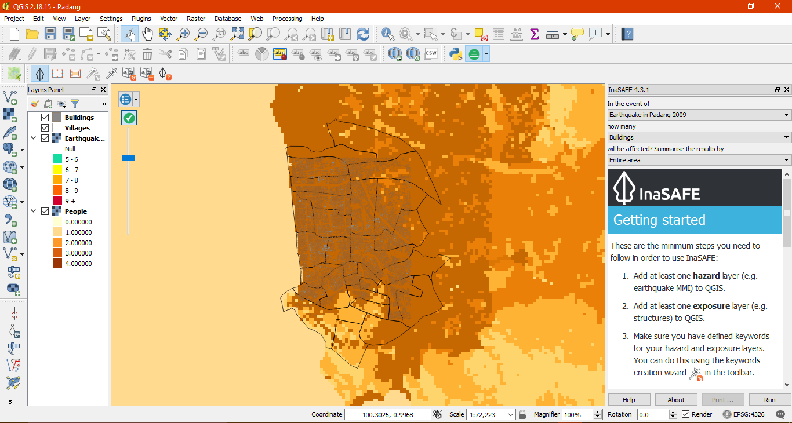

In the InaSAFE dock, note that the InaSAFE form is still empty. It means that your hazard and exposure data does not yet have keywords assigned.
Therefore, you must first define keywords for each dataset in the project.

To define keywords, please click on the **Keywords Creation Wizard** icon and follow the instructions provided. 
You can refer back to the Run Intermediate InaSAFE <run_intermediate_inasafe> module for step-by-step instructions.

While you define the hazard layer, please select hazard classifications for each exposure type. In this example, you must choose ‘Earthquake MMI Classes’ on Population and 'Generic Classes' on Structures Classifications to edit the threshold. Do not forget to save the thresholds before you continue to the next step.

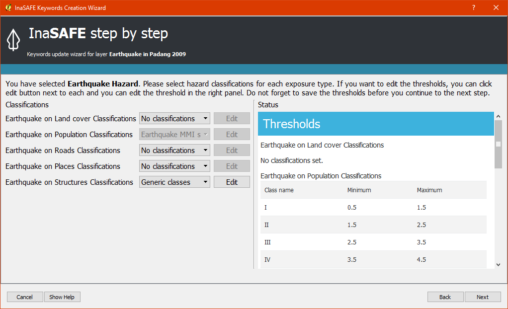

Once you have finished defining keywords for each layer, your InaSAFE form should look like this :

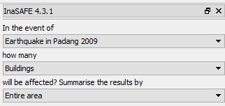

#### b. Run InaSAFE

Once your InaSAFE dock appears the same as the above image, you are ready to run an earthquake analysis on buildings.
It poses the question “In the event of an **Earthquake in Padang 2009**", how many **buildings** will **be affected?**.
Click **Run** on the bottom right corner in your InaSAFE Dock. If everything was set up correctly, you should get a result in the dock area after a few seconds, and a new map layer should be added to the map.
The new layer is named **Number of Buildings**.

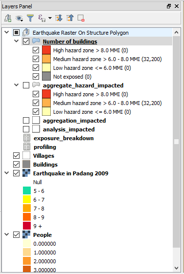

#### c. Interpret the Results

Let’s take a look at the new data layer generated from InaSAFE.

- Zoom in to any area in the Map Canvas

- There will be three new different colours generated from InaSAFE (light yellow, orange, and red).

- The red buildings are located in highly affected areas which have MMI Values greater than 8 MMI. The orange buildings are located in medium affected areas which have MMI between 6 to 8 MMI while the light yellow buildings are considered located in areas with low impact which have MMI Values of less than 6 MMI.

- Click **Number of Buildings** in the layer list to select it, click the **Identify Feature** tool, and then click on building to view attributes of the building.

!!! note
    Default Threshold  for Earthquake are 0-6 MMI for Low Threshold, 6.1-8 MMI for Medium and more than 8 MMI for high threshold. You can change the threshold of MMI Value for each affected area before running InaSAFE. Please run keyword wizard again and click Edit on Earthquake on Building. Don't forget to click Save. This configuration will make your result different with Run InaSAFE using default threshold.
    

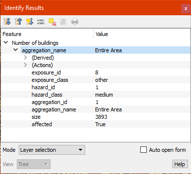

In the InaSAFE panel we now see the impact summary. Details are explained below.

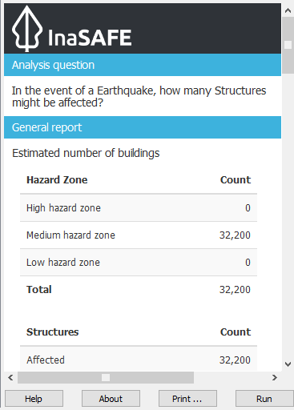

- **General report:** shows estimated number of buildings based on hazard zone and structures. **Hazard zone** divides the results into several categories based on the threshold set in the hazard analysis. In this impact summary, InaSAFE divides the impact buildings into three categories based on MMI. **Structures**  divides the results that shows the count of affected, not affected and not exposed buildings.

- **Analysis detail:** divides the exposed buildings into several categories based on the building type attribute for each building. In this impact summary, InaSAFE breaks down the results into a more detailed report by looking at each type of the building.

- **Action checklist:** designed to make disaster managers think about what they need to do/discuss when planning for a similar event in the future.

- **Notes and assumptions:** provides details about the input data and any limitations or assumptions in the analysis or report summary. In this example, it explains why buildings are said to be inundated, wet and dry.

- **Aggregation result:** statistical breakdown of the number of results. This example shows the count of important infrastructure. When you choose to use an aggregation layer with your analysis (we will do this later) this table will show the number of buildings by aggregation boundary.

- **Analysis details (source):** explanation of where the hazard data, exposure data, aggregation come from.

### 1.2 Run InaSAFE for Population

We are now ready to run our second InaSAFE analysis using earthquake data in Padang. We will be working with the same earthquake data again, but this time looking at the number of impacted people in a specific area.
If you finished defining keywords, these data should have keywords assigned so you will be ready to run InaSAFE.

In QGIS, turn off the **Buildings** and **estimated buildings affected** (the layers generated from InaSAFE analysis and turn ON the population layer).
Because we want to look at the number people who might be killed or displaced in a specific area, we also need to turn ON **the Village** layer in QGIS. 
This layer will be used as an aggregation layer that can show us the result for each administrative area. 
If you forget the steps needed to define a layer as an aggregation, please refer to the Run Intermediate InaSAFE. <run_intermediate_inasafe>

Confirm that the InaSAFE panel on the right side is set to query how many people will be affected :

- Earthquake in Padang 2009

- People

- Village

!!! note
    This particular impact function was developed in Italy in November 2013 during a code sprint.
    

Your InaSAFE form should appear like the below screenshoot:

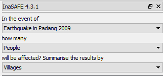

#### a. Run InaSAFE

If everything is setup correctly, the InaSAFE dock should show that you are ready to run a flood analysis on population.
It poses the question “In the event of an **Earthquake in Padang (2009)**, how many **people** will be **affected**?” 
In this analysis we still use Shakemap data which has values from 6 – 8 MMI. If you want to see the minimum relief needs that should be provided based on the result, you can click **Options** and select **Minimum Needs**.

You can refer to the Run Basic InaSAFE <run_basic_inasafe> to learn more about the basis of default minimum needs in InaSAFE
or if you want edit an item or add new minimum needs, you can refer to the `Minimum Needs Configuration manuals <http://docs.inasafe.org/en/user-docs/application-help/minimum_needs.html#minimum-needs>`__.
After everything is setup accordingly, click **Run** to process the new scenario.

#### b. Interpret The Result

If everything was set up correctly, you should get a result in the dock area after a few  seconds, and a new map layer should be added to the map.
The new impact layer will be called **People Displaced**. Let’s explore the result again to help you better understand its meaning :

- Turn off the **Number of Buildings** layer and drag the **People Displaced** above Earthquake in Padang 2009.

- Zoom in to the area you choose.

- Select **People Displaced** in the layer list and use the **Identify Feature** tool again to select a pixel (square) in the map canvas.

- In the screenshot below, clicking on one of the brown pixels displays a value of 98.94569, which means there are approximately 98 people in this one pixel (square) whom might be displaced.

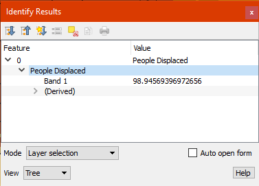

In the InaSAFE panel we now see the impact summary. The details are explained below.

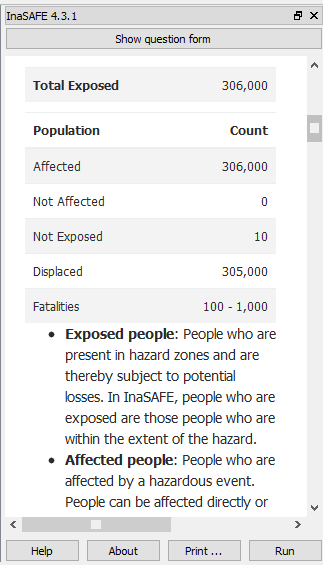

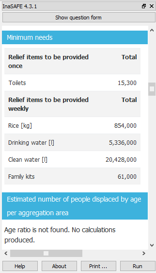

   
- **General report:** shows estimated number of affected people based on hazard zone and population. It is assumed that all of these people will need to be evacuated. **Hazard zone** divides the results into several categories based on the threshold set in the hazard analysis. In this impact summary,InaSAFE divides the affected people into several categories based on MMI classes. **Population**  divides the results that shows the count of displaced and fatalities.

- **Minimum needs:** are calculated numbers of food, water and other products needed by evacuated people on a weekly basis.

- **Action checklist:** designed to make disaster managers think about what they need to do/discuss when planning for a similar event in the future.

- **Notes and assumptions:** provides details about the input data and any limitations or assumptions in the analysis or report summary. In this example, it explains the total number of people in the analysis area and the source of minimum needs.

- **Detailed minimum needs report:** statistical breakdown of the number of total displaced population and minimum needs based on administrative area.

- **Detailed gender and age report:** provides a breakdown of the number of affected people by age (youth, adults and elderly) and gender based on the default world population demographics and calculates the minimum needs for women’s hygiene and pregnant women. If you using aggregation layer, the result will be broken down based on administrative area.

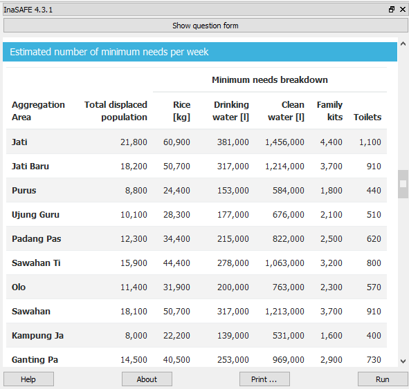

## 2. Run InaSAFE for Tsunami

The 1992 Flores earthquake occurred on December 12, 1992 on the island of Flores in Indonesia. With a magnitude of 7.8, it was the largest and also the deadliest earthquake in 1992.
This earthquake triggered another hazard in that area a tsunami in Maumere, Flores.

Next, we will run another scenario in InaSAFE using Tsunami Hazard Model.
It is a modelled version of a Magnitude 8.1 earthquake generating a tsunami which impacts Maumere.

### 2.1 Open Project

Please open the QGIS project file `Maumere.qgs` from the :file:`InaSAFE Training Data
> Maumere` folder. Once opened, the project should appear similar to the screenshot below:

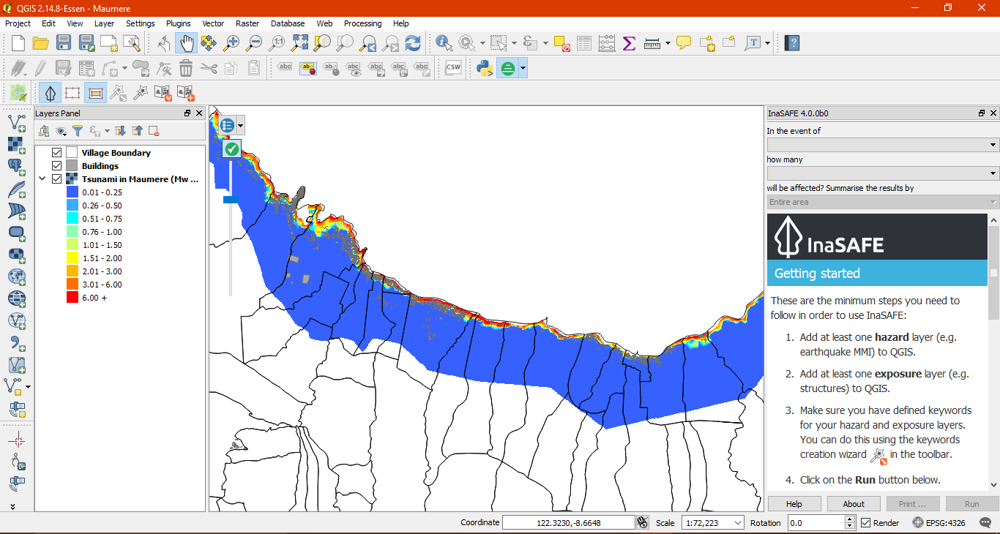

You will see in the InaSAFE dock that keywords for each layer have not yet been defined. As before, we use the **Keyword Creation Wizard** icon to define keyword. For detailed steps, please reference the Run Intermediate InaSAFE. <run_intermediate_inasafe> module

### 2.2 Run InaSAFE

Once you have finished defining keywords for each layer, your InaSAFE form should look like this :

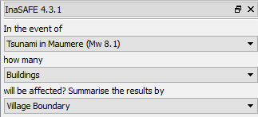

In this scenario we will use Buildings as an exposure and Village Boundary as an aggregation layer. Once your InaSAFE form appears the same as the above screenshoot,
click **Run** at the bottom right corner in your InaSAFE dock.

### 2.3 Interpret the Result

If everything was set up correctly, you should get a result in the dock area after a few  seconds, and a new map layer should be added to the map.
The new impact layer will be called Number of buildings.
Let’s explore the result again to help you understand more.

- Zoom in to any area you choose

- Here we have zoomed in to a location in Maumere. There will be five new different colours generated from InaSAFE (light yellow, orange, red, green, and grey).

- The red buildings are situated in area where the depth of tsunami inundation is more than 3 metres; the orange buildings are situated in area where the depth of tsunami inundation is between 1.0 and 3 metres; the light yellow are situated in area where the depth of tsunami inundation is 0.1 and 1.0 metres; the green buildings considered dry as they are situated in water less than the threshold of 0.1 metre; and the grey buildings considered not exposed by the hazard.

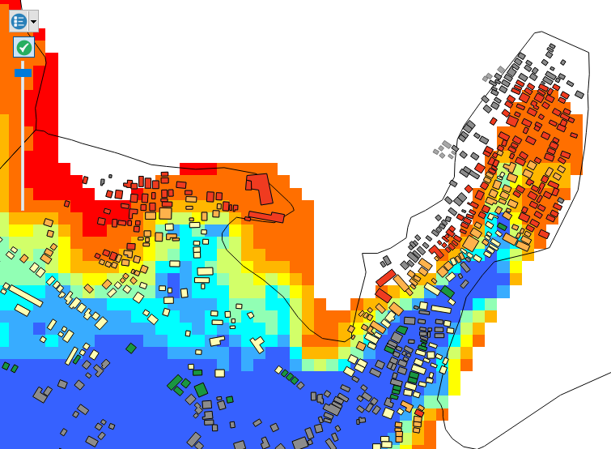

- Click **Number of buildings** in the layer list to select it and click **Identify Feature** tool and then click on building to know what attribute of the building.

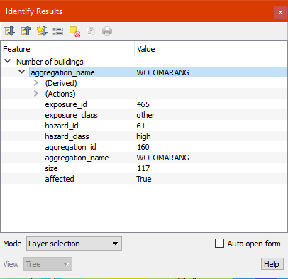

Here we clicked on one of the red building and find that there is a value of hazard class 'high'. This means that the building is located in an affected area which is predicted to be flooded more than 3 metres.

In the InaSAFE panel we now see the impact summary. Details are explained below.

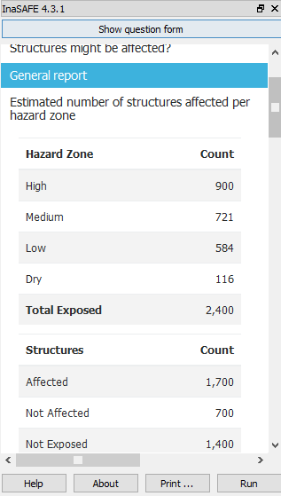

- **General report**: shows estimated number of buildings based on hazard zone and structures. **Hazard zone** divides the results into several categories based on the threshold set in the hazard analysis. In this impact summary, InaSAFE divides the impact buildings into four categories: number of building in low hazard zone, number of building in medium hazard zone, number of building in high hazard zone and number of dry buildings (not affected by any tsunami impact). **Structures**  divides the results that shows the count of affected, not affected and not exposed buildings.

- **Analysis detail**: divides the exposed buildings into several categories based on the building type attribute for each building. In this impact summary, InaSAFE breaks down the results into a more detailed report by looking at each type of the building.

- **Action checklist**: designed to make disaster managers think about what they need to do/discuss when planning for a similar event in the future.

- **Notes and assumptions**: provides details about the input data and any limitations or assumptions in the analysis or report summary. In this example, it explains why building are predicted to be inundated, wet and dry.

- **Aggregation result**: statistical breakdown of the number of impacted building based on administrative area.

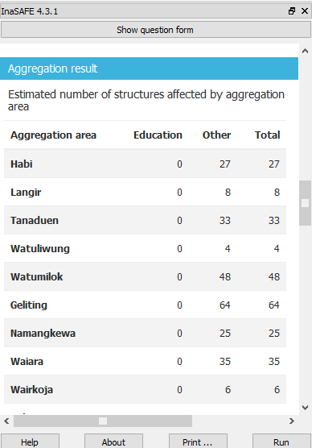

   
- **Analysis details (source)**:explanation of where the hazard data, exposure data, aggregation come from.

The results show the buildings that will be affected by tsunami starting from 1 metre. What if the disaster manager decides that buildings in 80 cm of water are also considered inundated? You can change the water depth threshold to see the result, refer to the Run Basic InaSAFE. <run_basic_inasafe> module.

!!! note
    InaSAFE Tsunami Impact Function is very similar with Flood, but due to the force of tsunami waves, the maximum depth of water that would affect people and infrastructure is shallower.
    

## 3. Run InaSAFE for Volcano

Indonesia has many volcanoes, and most of them are still active today. In fact, one of the most frequent disasters in Indonesia is volcano eruptions. There are 129 active volcanoes across the country,
and it is valuable to know how many people and how much infrastructure is within a certain perimeter of the vent.

InaSAFE also has an impact function for volcano eruption scenarios. This function can run some type of
hazard data. For detail information about the InaSAFE volcano hazard function, please look at the Hazard Data Section. <datasets> 

In this section we will be using the Sinabung volcano hazard from the National Disaster Management Agency (BNPB) as
hazard data and building from OpenStreetMap as exposure data. For this run, we will using
Impact Function Centric Wizard (IFCW). For more information about IFCW you can refer to 
Key concepts in disaster management planning with InaSAFE. <inasafe_concepts> 

### 3.1 Open Project

Please open a new QGIS project in order to use IFCW to run this project.
You new QGIS project should look like this:

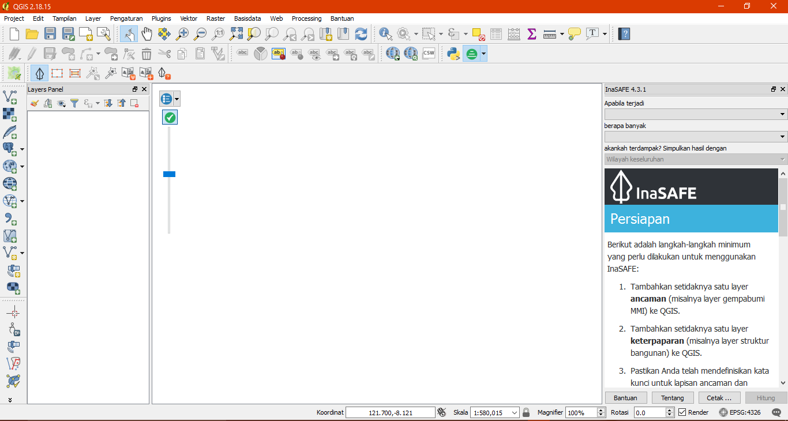

### 3.2 Run InaSAFE

To use the **Impact Function Centric Wizard**, please click **Impact Fuction Centric Wizard** icon.

After clicking that icon, you will see the following dialogue box appear:

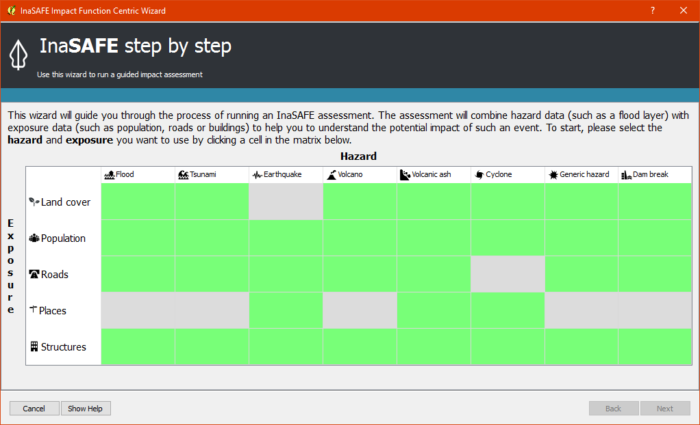

In the box above, there are some fields that help us select the scenario to use.
Green fields mean those scenarios are available and ready to run in InaSAFE. Grey fields means those scenarios are not available in InaSAFE at the moment.

Because we want to run Volcano with building in this session, please click **Field Volcano' and :guilabel: 'Structure**. The resulting dialogue box appears like this:

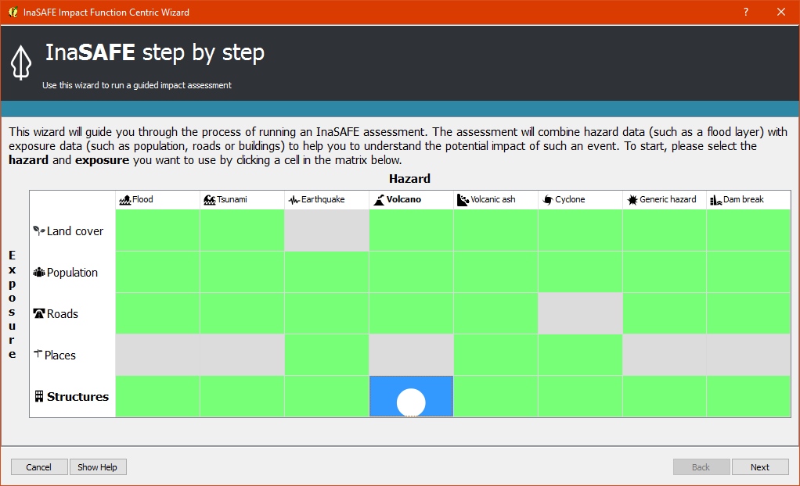

You can click **Next** and select the geometry types for the hazard and exposure layers, click **Polygon**.

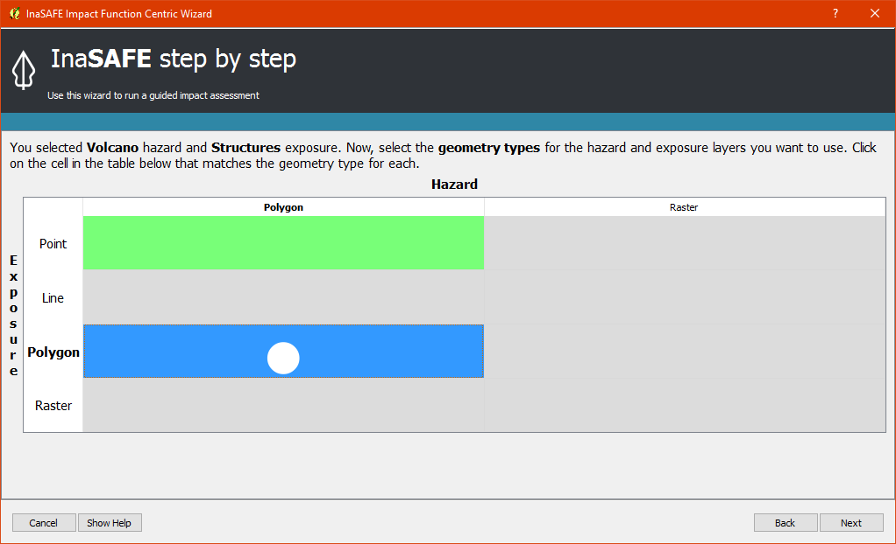

   
You can click **Next** and follow the instructions in the IFCW box.

Hazard Data that we want to use for this scenario can be found in `InaSAFE Training Data > Sinabung > Hazard Data` folder and please select `Sinabung_Hazard_Map_2015_WGS84.shp`.

Building Exposure data can be found in `InSAFE Training Data > Sinabung > Exposure Data` folder and please select `Sinabung_buildings_WGS84.shp` .

There is optional to use aggregation for your analysis, either you load aggregation layer from your own local file or you just aggregate results for the entire analysis windows.

!!! note
    The differences between Volcano and Volcanic Ash can be seen in Hazard Data Section <datasets>, and for detail explanation about type of data you can be found in Key concepts in disaster management planning with InaSAFE. <inasafe_concepts>.
    

If you have followed the instruction in IFCW box, before running InaSAFE you should see the final form below:

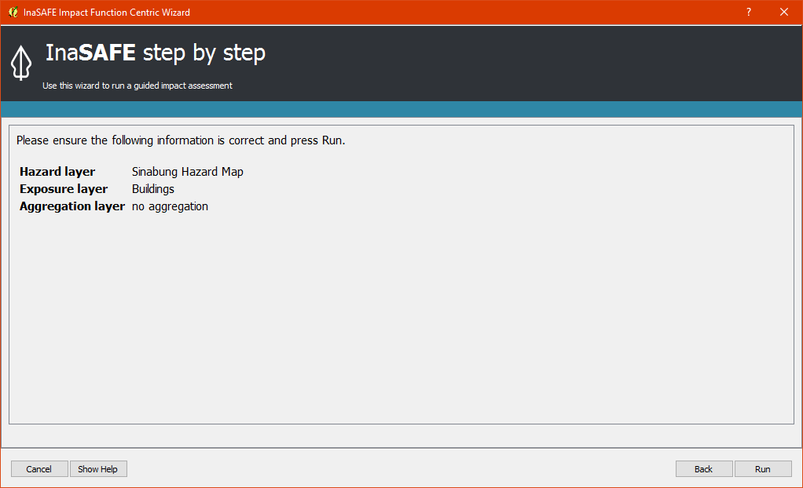

If your IFCW box looks like the screenshot above, click **Run** and wait for analysis processing until a result box appears.

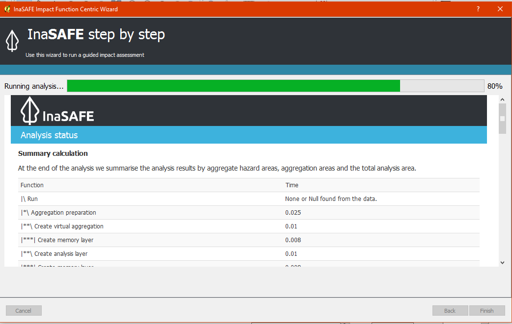

### 3.3 Interpret the Result

Once you have finished running the analysis, you will see the result has new layer named
“Number of buildings” . This layer will show you which buildings are affected for each hazard zone.
There will be four new colours of building generated from InaSAFE (light yellow, orange, red, and grey).

The light yellow buildings mean these buildings are located in a Low Risk Zone (Risk Zone 1), the orange buildings mean these buildings are located in an Intermediate Risk Zone (Risk Zone 2), red buildings are considered situated in a High Risk Zone (Risk Zone 3) of Sinabung Volcano, and grey buildings considered not exposed by the hazard.

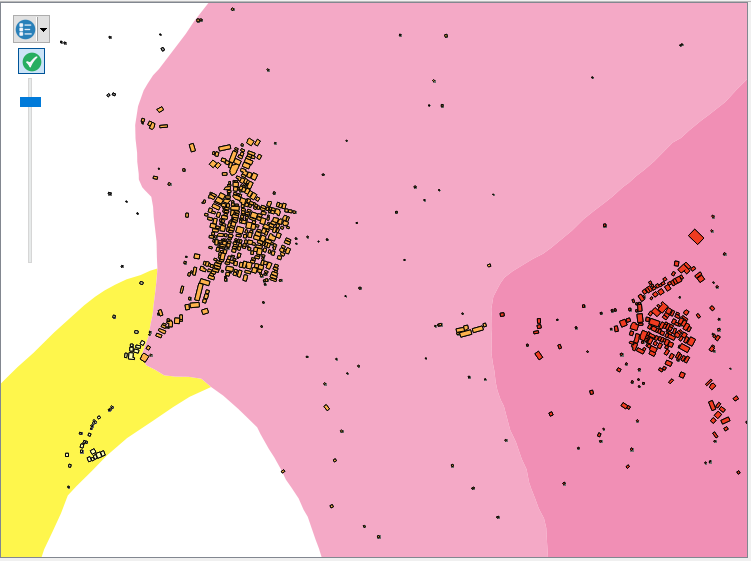

In the InaSAFE result box, we now see the impact summary. It is very similar to the InaSAFE Dock. Details are explained below.

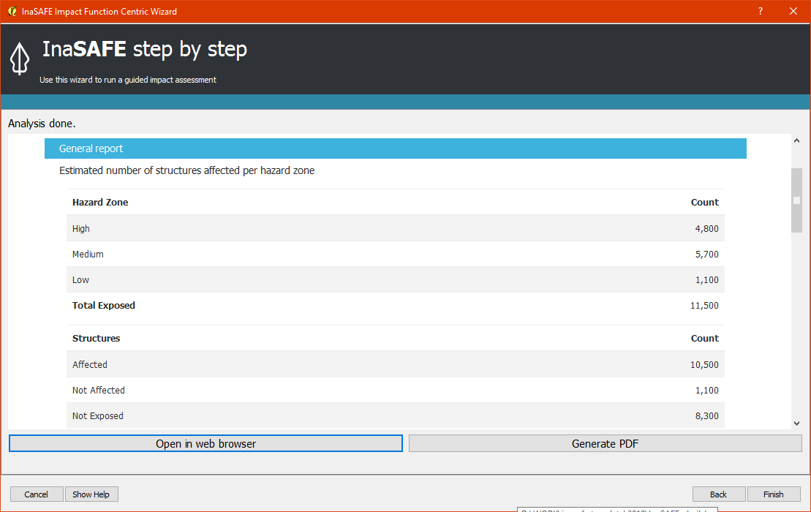

- **General report**: shows estimated number of buildings based on hazard zone and structures. **Hazard zone** divides the results into several categories based on the threshold set in the hazard analysis. In this impact summary, InaSAFE divides the impacted buildings into three categories for each hazard zone of Sinabung Volcano. **Structures**  divides the results that shows the count of affected, not affected and not exposed buildings.

- **Analysis detail**: divides the exposed buildings into several categories based on the building type attribute for each building.

- **Action checklist**: designed to make disaster managers think about what they need to do/discuss when planning for a similar event in the future.

- **Notes and assumptions**: provides details about the input data and any limitations or assumptions in the analysis or report summary.

- **Aggregation result**: statistical breakdown of the number of impacted building based on administrative area.

- **Analysis details (source)**: explanation of where the hazard data, exposure data, aggregation come from.

You have now run InaSAFE for a volcano scenario using the Impact Function Centric Wizard (IFCW).
Quite different than the InaSAFE Dock, this tool is designed to help a user run InaSAFE more easily without needing to open all the required data one by one in QGIS. IFCW provides precise guidance and detail about
what actions should be taken step by step until the scenario is ready to run. This tool is very useful, especially for InaSAFE user who are less familiar with QGIS and Spatial Data.

## 4. Generic Hazard Impact Function in InaSAFE

InaSAFE can run analyses for multiple hazards, using scenarios that we set up based on data availability. These scenarios include seven types of hazards : floods, earthquakes, volcanos, volcanic ash, tsunamis, dam break, and, cyclone. What if our hazard scenario is not included in this list (for example, a land slide or drought). To solve this problem, InaSAFE provides a tool called the **Generic Hazard Impact Function** that can run analyses for any hazard not available via a specific Scenario Impact Function.

### 4.1 Open Project

Next, we will explore this tool using a landslide hazard in Nagekeo, East Nusa Tenggara with building and population data
for each scenario. Please open the QGIS project file `Nagekeo.qgs` from 
the `InaSAFE Training Data > Nagekeo` folder. Once opened, the project should look like the screenshot below:

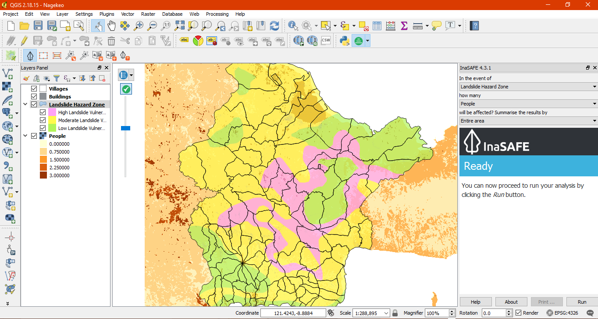

In the InaSAFE dock, the InaSAFE form still appears empty. This means that your hazard and
exposure data lacks keywords. Before proceeding, you should define keywords for each dataset in this project.

To define a keyword, please click on the **Keywords Creation Wizard** icon

and follow the instructions. You can refer to the Run Intermediate InaSAFE. <run_intermediate_inasafe> if you need additional assistance.
Once you finish defining keyword for each layer, your InaSAFE form should appear like the below screenshot:

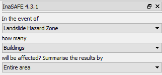

### 4.2 Run InaSAFE for Building

#### a. Run InaSAFE

Your InaSAFE Dock now poses the question “In the event of **Landslide Hazard Zone**, how many **buildings** will **be affected**?" 
Click **Run** on the bottom right corner in your InaSAFE Dock.
If everything was set up correctly, you should get a result in the dock area after a few seconds, and a new map layer should be added to the map. The new layer will be named “Number of buildings”.

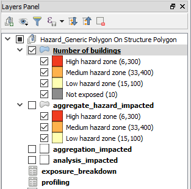

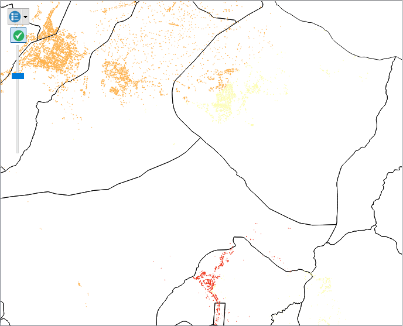

#### b. Interpret The Result

Let’s take a look at the new data layer generated from InaSAFE:

- Zoom in to an area in the Map Canvas

- There will be three new colours generated from InaSAFE (red, orange, light yellow and grey).

- The red buildings are located in a high vulnerability zone, the orange buildings are located in moderate vulnerability zone, light yellow buildings are located in a Low Landslide Vulnerability Zone and the grey buildings are not exposed by the landslide.

- Click building affected in the layer list to select it. Next, click the **Identify Feature** tool and then click on a building to view attributes of the building.

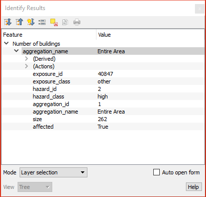

In the InaSAFE panel we now see the impact summary. Details are explained below.

- **General report**: shows estimated number of buildings based on hazard zone and structures. **Hazard zone** divides the results into several categories based on the threshold set in the hazard analysis. In this impact summary, InaSAFE divides the impacted buildings into three categories for each hazard zone of Landslide. **Structures**  divides the results that shows the count of affected, not affected and not exposed buildings.

- **Analysis detail**: divides the exposed buildings into several categories based on the building type attribute for each building.

- **Action checklist**: designed to make disaster managers think about what they need to do/discuss when planning for a similar event in the future.

- **Notes and assumptions**: provides details about the input data and any limitations or assumptions in the analysis or report summary.

- **Aggregation result**: statistical breakdown of the number of impacted building based on administrative area.

- **Analysis details (source)**: explanation of where the hazard data, exposure data, aggregation come from.

### 4.3 Run InaSAFE for Population

#### a. Run InaSAFE

Turn off the Buildings Affected by each hazard zone (the layers generated from InaSAFE analysis and
turn ON the **People** layer. Since we want to look at the number of people who might die or be displaced in
a specific area, we also need to turn ON the **Village** layer in QGIS. This layer will be used as an aggregation layer that
can show us results grouped by administrative boundary.

If you forget the steps to define an aggregation layer, refer to the Run Intermediate InaSAFE. <run_intermediate_inasafe> section.
Edit the question form in the InaSAFE Dock so that it appears similar to the below screenshot:

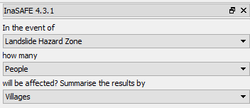

Next, click **Run** to start the analysis.

#### b. Interpret the Result

If everything was set up correctly, you should get a result in the dock area after a few  seconds,
and a new map layer should be added to the map. The new impact layer will be called **Number of People**.
Let’s explore the result again to help you understand more.

- Zoom in to any area.

- Select Number of people in the layer list and use the **Identify Feature** tool again to select a pixel (square) in the map canvas.

Here we clicked on the red zone and find that there is a value of hazard class ‘high’. This means that the people is located in affected area which is predicted as high hazard zone.

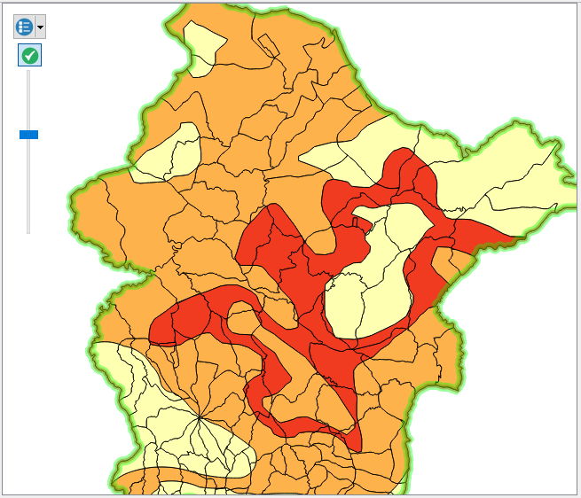

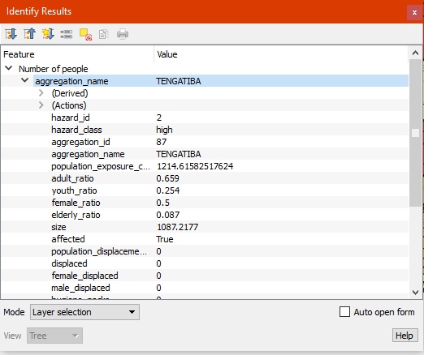

In the InaSAFE panel we now see the impact summary. The details are explained below.

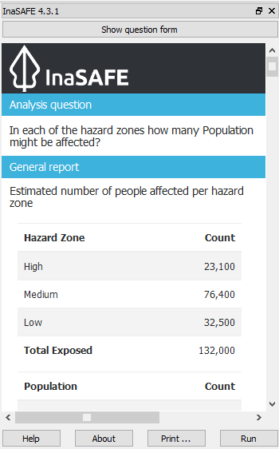

- **General report:** shows estimated number of affected people based on hazard zone and population. It is assumed that all of these people will need to be evacuated. **Hazard zone** divides the results into several categories based on the threshold set in the hazard analysis. **Population**  divides the results that shows the count of displaced and fatalities.

- **Minimum needs:** are calculated numbers of food, water and other products needed by evacuated people on a weekly basis.

- **Action checklist:** designed to make disaster managers think about what they need to do/discuss when planning for a similar event in the future.

- **Notes and assumptions:** provides details about the input data and any limitations or assumptions in the analysis or report summary. In this example, it explains the total number of people in the analysis area and the source of minimum needs.

- **Detailed minimum needs report:** statistical breakdown of the number of total displaced population and minimum needs based on administrative area.

- **Detailed gender and age report:** provides a breakdown of the number of affected people by age (youth, adults and elderly) and gender based on the default world population demographics and calculates the minimum needs for women’s hygiene and pregnant women. If you using aggregation layer, the result will be broken down based on administrative area.

!!! note
    In the result of InaSAFE, Action Checklist and Notes might be unrelated with hazard that we run.
    For instance, if we run drought hazard the action checklist might have some topics such as how many building closed, or people die or displaced. Those topics are not really related with drought. 
    

## Summary

Congratulation! You have now learned to use most of InaSAFE's functionality. You can run analyses for specific hazard using tools such as
the Impact Function Centric Wizard (IFCW) and the Generic Impact Function which will make using InaSAFE easier.

Now, to become an expert user of InaSAFE, try utilising all those tools that you explored in this module using your own scenarios and data, and practice interpreting the results.
